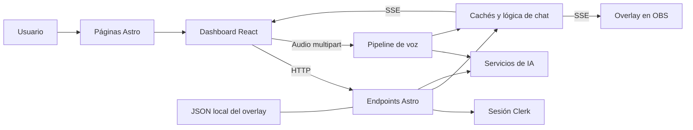
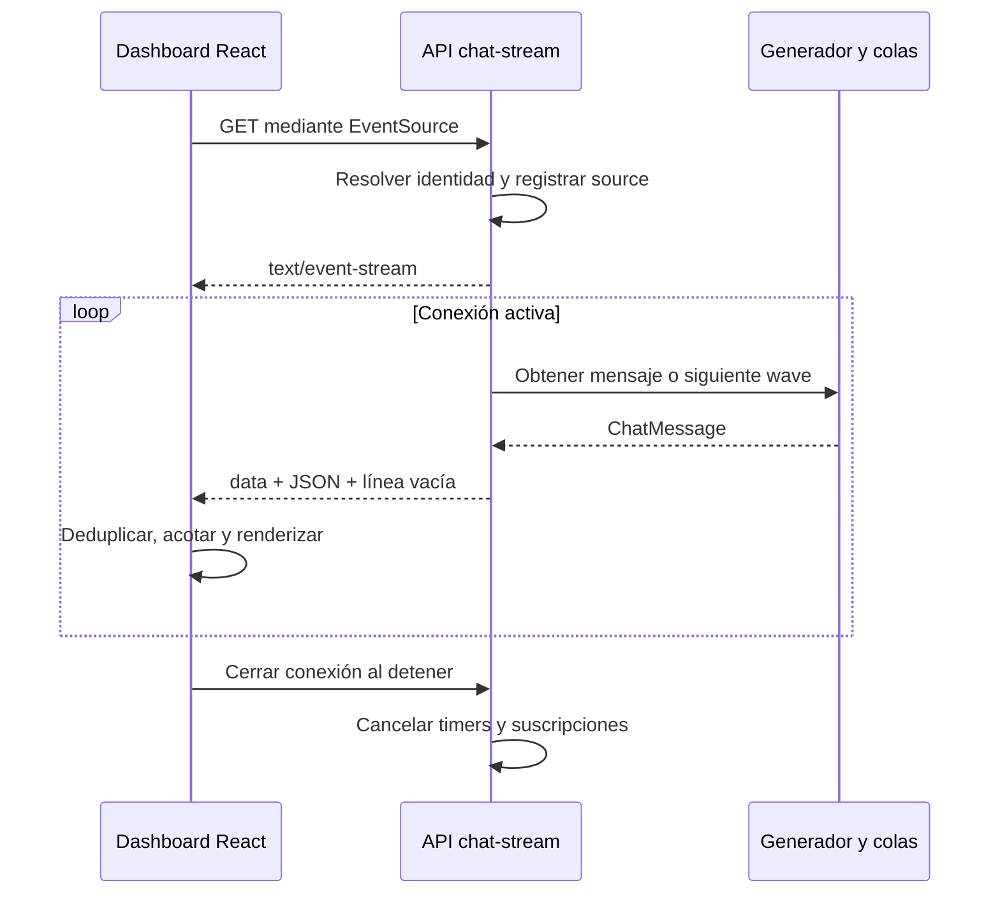
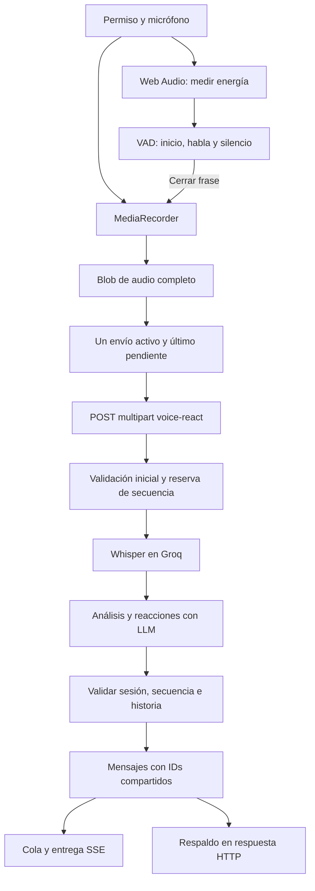

# Twick: libro de estudio para defender tu proyecto en una entrevista técnica

Esta guía te enseña a explicar **qué construiste, cómo se conectan sus piezas y qué límites tiene su implementación actual**. Está basada en la lectura del código y la configuración de este repositorio, realizada el 19 de octubre de 2026. Su objetivo es que puedas razonar con el entrevistador, recorrer el código y justificar decisiones con evidencia; memorizar nombres de librerías será solamente una parte de la preparación.

**Cómo estudiar:** primero entiende el recorrido de un mensaje, después profundiza en React, servidor, voz y seguridad. Al terminar cada capítulo, cierra el documento e intenta explicarlo con tus propias palabras. Cuando puedas señalar el archivo que respalda tu explicación y reconocer una limitación, estarás preparado para conversar sobre ese tema con profundidad.

> **Alcance de la evidencia.** Se inspeccionaron fuentes, configuración, dependencias y pruebas existentes. Esta preparación no ejecutó el servidor, los proveedores de IA, OBS, los tests ni un despliegue. Por tanto, “implementado” significa que el mecanismo está presente en el código; no significa que se haya medido su rendimiento o validado todo su comportamiento en producción. Ningún documento puede anticipar todas las preguntas posibles de una entrevista.

## Índice de estudio

1. [Tu proyecto explicado en una página](#1-tu-proyecto-explicado-en-una-página).
2. [Stack real y herramientas](#2-stack-real-y-herramientas).
3. [Arquitectura y fronteras](#3-arquitectura-y-fronteras).
4. [Astro: servidor, páginas e islas](#4-astro-servidor-páginas-e-islas).
5. [React: estado, efectos y coordinación](#5-react-estado-efectos-y-coordinación).
6. [Rendimiento: qué optimiza Twick y qué no está medido](#6-rendimiento-qué-optimiza-twick-y-qué-no-está-medido).
7. [Diseño visual, Tailwind y experiencia](#7-diseño-visual-tailwind-y-experiencia).
8. [El recorrido de las frases y los mensajes](#8-el-recorrido-de-las-frases-y-los-mensajes).
9. [SSE: el chat en tiempo real](#9-sse-el-chat-en-tiempo-real).
10. [IA: contratos, proveedores y fallos](#10-ia-contratos-proveedores-y-fallos).
11. [Voz: audio, contexto y concurrencia](#11-voz-audio-contexto-y-concurrencia).
12. [Emotes 7TV y realismo](#12-emotes-7tv-y-realismo).
13. [OBS, tokens y persistencia](#13-obs-tokens-y-persistencia).
14. [Autenticación, validación y seguridad](#14-autenticación-validación-y-seguridad).
15. [TypeScript y diseño de datos](#15-typescript-y-diseño-de-datos).
16. [SEO, recursos y distribución](#16-seo-recursos-y-distribución).
17. [Pruebas y estrategia de verificación](#17-pruebas-y-estrategia-de-verificación).
18. [Límites y oportunidades que conviene reconocer](#18-límites-y-oportunidades-que-conviene-reconocer).
19. [Inventario del proyecto](#19-inventario-del-proyecto).
20. [Banco de preguntas con respuestas](#20-banco-de-preguntas-con-respuestas).
21. [Ejercicios de entrevista y plan de siete días](#21-ejercicios-de-entrevista-y-plan-de-siete-días).
22. [Tus presentaciones de 90 segundos y tres minutos](#22-tus-presentaciones-de-90-segundos-y-tres-minutos).
23. [Glosario y fuentes de consulta](#23-glosario-y-fuentes-de-consulta).

### Cuatro etiquetas que debes aprender a distinguir

| Etiqueta | Qué significa al defender el proyecto |
|---|---|
| **Implementado** | Hay código o configuración que realiza ese mecanismo. |
| **Interpretación técnica** | Es una ventaja o intención razonable deducida de la estructura; no prueba por qué el autor la eligió históricamente. |
| **Por verificar** | Se detectó un límite o indicio que requiere una prueba concreta antes de declararlo defecto de ejecución. |
| **Evolución posible** | Es una propuesta de mejora, no una capacidad que ya tenga Twick. |

En una entrevista, di “la estructura permite…” cuando expliques un beneficio deducido. Usa “medimos…” solamente si tienes una medición real. Di “revisaría…” cuando plantees una mejora. Esta precisión transmite más experiencia que exagerar el alcance del proyecto.

## 1. Tu proyecto explicado en una página

**Twick es una aplicación web para practicar streaming con una audiencia simulada.** El usuario elige un juego o un tema de conversación, ajusta la personalidad y la velocidad del chat, y recibe mensajes que se presentan con estética de Twitch o Kick. Puede abrir un overlay en OBS y usar voz para generar reacciones relacionadas con lo que dice.

La idea técnica más importante es que **generar contenido y mostrarlo son actividades distintas**. El servidor puede preparar frases mediante IA y después producir mensajes a partir de ese material, combinándolo con nombres, categorías, emotes y eventos. El navegador recibe un flujo de mensajes; no necesita pedir al modelo un texto nuevo cada vez que aparece una línea.

La parte de voz añade otra dificultad: las respuestas llegan de forma asíncrona y pueden quedarse obsoletas si el usuario cambia de sesión, vuelve a hablar o detiene el micrófono. El proyecto tiene lógica específica para acotar el contexto y evitar que respuestas antiguas contaminen la conversación actual.

### Las cinco ideas que debes poder explicar sin mirar

1. **Astro organiza la aplicación y sirve el backend.** React se ocupa de las zonas interactivas.
2. **El estado de la interfaz vive principalmente en React.** No hay Zustand en el código de la aplicación inspeccionado.
3. **SSE transporta mensajes del servidor al navegador.** Las acciones del usuario viajan mediante otras peticiones HTTP.
4. **La IA se encapsula detrás de servicios y contratos.** El código administra proveedores, respuestas estructuradas, contexto y fallos.
5. **Hay estado de proceso y una persistencia local de overlay.** No equivale a una base de datos compartida entre varias réplicas.

### Un ejemplo narrado del producto

“Escribo el nombre de un juego. El frontend valida el dato y solicita frases al servidor. El servidor comprueba la identidad y aplica sus reglas antes de consultar el caché o los servicios de IA. Después inicio el chat y se abre una conexión SSE. El servidor programa envíos, construye mensajes y los manda como eventos. React incorpora esos mensajes a una lista acotada, y la ventana usa virtualización para renderizar lo necesario. Si abro OBS, otro consumidor puede recibir el flujo de overlay utilizando un token. Si activo el micrófono, el navegador captura audio y el servidor lo transcribe y genera reacciones que se incorporan al chat.”

Aprende esta historia primero. Las siguientes secciones explican cada verbo: validar, autenticar, generar, programar, enviar, renderizar y coordinar.

## 2. Stack real y herramientas

**La autoridad para las versiones es la configuración y el lockfile del checkout.** Parte de la documentación anterior menciona Astro 5 y Vercel; la configuración actual utiliza Astro 6 y un adaptador de Node. Explica el estado presente y, si surge la discrepancia, reconócela como documentación que quedó atrás.

Referencia: [package.json](/Users/alan/Documents/Dev/projects/twick/package.json:15), [astro.config.mjs](/Users/alan/Documents/Dev/projects/twick/astro.config.mjs:13) y [pnpm-lock.yaml](/Users/alan/Documents/Dev/projects/twick/pnpm-lock.yaml).

| Tecnología | Versión resuelta observada | Para qué aparece en Twick |
|---|---|---|
| Astro | 6.3.1 | Rutas, renderizado, endpoints, actions e integración del frontend. |
| React / React DOM | 19.2.6 | Dashboard, mensajes, controles y estado interactivo. |
| TypeScript | 6.0.3 | Contratos y comprobación estática con modo estricto. |
| Tailwind CSS / plugin Vite | 4.3.0 | Utilidades, tokens visuales e integración de estilos. |
| `@astrojs/node` | 10.1.0 | Servidor standalone para el resultado de producción. |
| `@astrojs/react` | 5.0.4 | Renderizado e hidratación de componentes React en Astro. |
| `@clerk/astro` | 3.2.2 | Integración de identidad y sesión. |
| `react-virtuoso` | 4.18.7 | Virtualización de la lista de chat. |
| `groq-sdk` | 1.2.0 | Comunicación del servidor con Groq. |
| SDK de Cerebras | 1.64.1 | Segundo proveedor de generación de texto. |
| `@astrojs/sitemap` | 3.7.2 | Generación de sitemap con filtros de rutas. |
| Tabler React | 3.44.0 | Iconos de interfaz importados explícitamente. |
| Sharp | 0.35.5, fijada | Procesamiento de imágenes y dependencia unificada mediante override. |
| `@astrojs/check` | 0.9.9 | Comprobación del proyecto Astro. |
| Node.js | `engines >=22` | Runtime del servidor y de los tests de Node. |
| pnpm | Sin requisito fijado en `package.json` | Gestión de dependencias, scripts y lockfile. |

**Matiz de Node:** aunque `package.json` permite `>=22`, las dependencias resueltas de Astro/Vite exigen una versión compatible de la rama 22 a partir de 22.12.0. El entorno observado usa Node 24.15.0 y pnpm 11.9.0; eso describe el equipo inspeccionado, no un requisito adicional del proyecto. Los tipos `@types/node` 25.7.0 tampoco convierten el runtime en Node 25.

### 2.1 Framework, librería y runtime: no son sinónimos

**Astro es el framework:** organiza rutas, build, renderizado y convenciones de archivos. **React es una librería de interfaz:** describe componentes y sus actualizaciones. **Node es el runtime:** ejecuta JavaScript del servidor fuera del navegador. **TypeScript es el lenguaje y su comprobador:** añade información de tipos; esos tipos no se convierten automáticamente en validación de las peticiones.

Una respuesta clara sería: “La aplicación corre en Node, Astro organiza la web y el backend, y React maneja el dashboard. TypeScript ayuda a mantener consistentes los contratos entre esas partes”.

### 2.2 ESM y dependencias reproducibles

Fragmento real de `package.json`, líneas 2–9:

```json
  "name": "Twick chat-simulator",
  "type": "module",
  "version": "2.0.0",
  "scripts": {
    "dev": "astro dev",
    "build": "astro build",
    "preview": "astro preview",
    "start": "node ./dist/server/entry.mjs",
```

`"type": "module"` indica que el proyecto utiliza módulos ES. Por eso ves `import` y `export`, y el entrypoint de producción termina en `.mjs`. Un módulo puede exportar funciones o tipos y otro puede importarlos; esa separación permite organizar responsabilidades sin copiar código.

`package.json` expresa los rangos aceptados; `pnpm-lock.yaml` registra la resolución concreta de dependencias y sus relaciones. `^6.3.1` y “resuelto 6.3.1” son afirmaciones distintas. Para reproducir la resolución en un entorno nuevo, la práctica habitual es instalar respetando el lockfile, por ejemplo con `pnpm install --frozen-lockfile`.

### 2.3 Override de Sharp y ejecución de scripts de dependencias

Referencia: [pnpm-workspace.yaml](/Users/alan/Documents/Dev/projects/twick/pnpm-workspace.yaml:9).

```yaml
overrides:
  'astro>sharp': 0.35.5

allowBuilds:
  '@clerk/shared': true
  esbuild: true
  sharp: true
```

Un **override** fuerza una versión dentro del árbol de dependencias. Aquí unifica el Sharp usado por Astro con la versión directa 0.35.5. Los comentarios del archivo vinculan la decisión con correcciones de seguridad de procesamiento de imágenes. Es evidencia de una intervención específica sobre dependencias, no una auditoría completa ni una garantía de ausencia de vulnerabilidades.

`allowBuilds` controla qué paquetes pueden ejecutar sus pasos de instalación. Es relevante porque herramientas como esbuild y Sharp utilizan componentes binarios. El entrevistador puede preguntarte por la cadena de suministro: además de tu propio código, también ejecutas y distribuyes código de terceros. Fijar resoluciones y limitar scripts ayuda a controlar esa superficie, pero exige mantenimiento.

### 2.4 Herramientas presentes y herramientas ausentes

| Presente en la aplicación | No observado como implementación actual |
|---|---|
| React hooks, props y estado local elevado | Zustand o Redux. |
| Endpoints HTTP y SSE | WebSocket. |
| Maps/cachés en memoria y JSON local del overlay | Redis, Supabase o una base SQL. |
| Node standalone | Adaptador actual de Vercel o ISR configurado. |
| Tests de Node y scripts Python de Playwright | Framework JS de tests como Vitest o Jest. |
| Manifest web | Service worker que garantice funcionamiento offline. |
| Configuración del proyecto y VS Code | Dockerfile o pipelines de `.github` versionados observados. |

No necesitas añadir una herramienta para que el proyecto sea defendible. Necesitas entender qué problema resuelve la solución actual y cuándo dejaría de ser suficiente.

## 3. Arquitectura y fronteras

**Twick es una aplicación integrada con frontend y servidor en el mismo repositorio.** Separa responsabilidades mediante carpetas y contratos, aunque no despliega un microservicio por cada una. Es una arquitectura apropiada para estudiar porque permite seguir un comportamiento completo desde el botón hasta el proveedor de IA.



### 3.1 Las fronteras que debes vigilar

| Frontera | Qué cruza | Qué debes comprobar |
|---|---|---|
| Navegador → servidor | Parámetros, texto, audio y peticiones | Identidad, forma, límites y permisos. |
| Servidor → proveedor de IA | Prompts, contexto y audio | Secretos, errores, tiempos y respuesta no confiable. |
| Servidor → navegador | Mensajes, eventos y configuración | Serialización, orden, cierre y actualización de estado. |
| Proceso → disco | Tokens y ajustes de overlay | Lectura, escritura, expiración y alcance de la persistencia. |
| Dashboard → OBS | URL y token del overlay | Qué autoriza el token, cuánto dura y cómo se revoca. |

La red impone una regla importante: aunque el frontend tenga tipos perfectos, una petición puede venir de otro cliente. Un atacante no necesita usar tu formulario. La validación relevante para proteger recursos ocurre en el servidor.

### 3.2 Cohesión y acoplamiento en tu repositorio

**Cohesión** es que un archivo agrupe tareas relacionadas. `phraseCache.ts` se ocupa del almacenamiento temporal de frases; `overlayTokens.ts`, de los tokens; `useVoiceCapture.ts`, del ciclo del micrófono. **Acoplamiento** es cuánto depende una pieza de los detalles de otra. Los tipos compartidos y las funciones exportadas permiten coordinar módulos mediante contratos visibles.

Eso no significa que toda separación sea perfecta. `StreamerDashboard.tsx` coordina muchos comportamientos y `src/utils/types.ts` reúne un contrato amplio. Puedes defender su utilidad actual y reconocer que, si crecen más, convendría separar dominios sin fragmentarlos por costumbre.

### 3.3 Datos efímeros y datos persistidos

Un **Map de módulo** vive mientras vive ese proceso Node. Puede ser rápido y sencillo, pero desaparece al reiniciar y no se comparte automáticamente con otra réplica. Un **archivo JSON** sobrevive al reinicio solo si el disco se conserva. Tampoco ofrece por sí solo las garantías de concurrencia y consulta de una base de datos.

Esta distinción explica varias respuestas de escalabilidad: el diseño actual puede coordinar componentes dentro de una instancia; distribuirlo entre instancias requiere decidir cómo compartir tokens, configuraciones, límites, sesiones de voz y eventos. La respuesta no es solamente “poner Redis”, sino definir qué datos necesitan consistencia, cuánto deben durar y qué ocurre si una instancia falla.

## 4. Astro: servidor, páginas e islas

**Astro combina páginas que entregan HTML con componentes interactivos que pueden hidratarse en el navegador.** En Twick, el contenido de presentación usa muchos componentes `.astro`; el dashboard y el overlay necesitan React para responder a eventos, mantener conexiones y actualizar mensajes.

### 4.1 SSR, SSG e hidratación

**SSR** significa producir HTML en el servidor al atender una petición. **SSG o prerenderizado** significa producirlo durante el build. **Hidratación** significa que JavaScript conecta comportamiento interactivo con una interfaz renderizada. Son ejes diferentes: una página puede entregar HTML desde el servidor y después hidratar una isla React.

Referencia: [astro.config.mjs](/Users/alan/Documents/Dev/projects/twick/astro.config.mjs:13).

```js
export default defineConfig({
  site: 'https://twick.dev',
  output: 'server',
```

Y el adaptador actual, líneas 63–65:

```js
  adapter: node({
    mode: 'standalone',
  }),
```

`output: 'server'` establece el modo de servidor. No demuestra por sí solo que toda ruta tenga el mismo coste ni que todas las páginas se prerendericen. Para afirmar que una ruta es estática hay que comprobar su configuración concreta, por ejemplo un `export const prerender = true` cuando corresponda.

`standalone` genera un servidor que puede iniciarse mediante el script `start`. Describe el artefacto de ejecución; no demuestra dónde está desplegado en este momento. El README menciona infraestructura, pero no se verificó una plataforma desplegada durante este análisis.

### 4.2 Componentes Astro frente a componentes React

Referencia: [src/pages/index.astro](/Users/alan/Documents/Dev/projects/twick/src/pages/index.astro:11).

```astro
<Layout
  title="Twick: Simulador de Chat para Streamers con IA"
  description="Simulador de chat con IA, configura una audiencia para tu tema o videojuego favorito, compatible con overlay de OBS y 7TV"
  type="website"
>
  <main role="main">
    <HeroSection />
    <DemoVideoSection />
    <HowItWorksSection />
    <FeaturesSection />
    <FinalCtaSection />
  </main>
</Layout>
```

La página ensambla secciones con responsabilidades visibles. El frontmatter de Astro importa componentes y prepara datos; la plantilla define el resultado. No hace falta convertir cada bloque de texto en una aplicación React para que aparezca en el navegador.

**Interpretación técnica:** mantener las secciones informativas en Astro puede reducir JavaScript de hidratación respecto de hacer toda la landing como un árbol React interactivo. La cantidad realmente enviada debe comprobarse en el build y en las herramientas de red; aquí no se midió.

### 4.3 Directivas de cliente: saber cuándo empieza el trabajo

Las directivas `client:*` permiten elegir cómo se activa una isla. En tu estudio debes distinguir `client:load` —inicio de hidratación al cargar—, `client:visible` —cuando entra en el área visible— y `client:only="react"` —renderizado del componente solo en cliente—. Esas definiciones ayudan a leer los puntos de montaje reales del proyecto; no significan que Twick utilice todas las variantes.

El beneficio y el coste cambian según el componente. Un dashboard con APIs del navegador puede justificar trabajo en cliente; una sección informativa no necesita el mismo tratamiento. Si te preguntan “¿por qué no usar React para todo?”, responde desde la responsabilidad y el coste, no desde una preferencia por un framework.

Punto de montaje real: [dashboard.astro](/Users/alan/Documents/Dev/projects/twick/src/pages/dashboard.astro:160).

```astro
<StreamerDashboard client:only="react" initialOverlayToken={initialOverlayToken} />
```

El shell y la obtención inicial de identidad/token se procesan en servidor; este árbol React se monta en cliente. Es más preciso que decir “todo el dashboard React tiene SSR”. El overlay también usa `client:only`, mientras que `PlatformToggle` se monta con `client:load`. No se encontraron usos de `client:visible`, `client:idle`, `React.lazy` o `Suspense` en la aplicación inspeccionada; conocer esas opciones no permite atribuirlas al proyecto.

`Layout` centraliza el documento habitual, aunque el overlay y la página de diagnóstico `/dev/chat` escriben su propio shell HTML. Es una excepción de la implementación a la norma general de AGENTS. En el overlay tiene sentido técnico buscar un documento transparente y mínimo para captura, pero no se debe ocultar esa diferencia entre norma y código.

Consulta oficial: [directivas de Astro](https://docs.astro.build/en/reference/directives-reference/) y [adaptador Node](https://docs.astro.build/en/guides/integrations-guide/node/).

### 4.4 Rutas, endpoints y actions

En Astro, la ubicación bajo `src/pages` determina rutas. Un archivo `src/pages/api/chat-stream.ts` exporta un manejador HTTP; `src/pages/dashboard.astro` produce una página. El nombre `GET` o `POST` corresponde al método HTTP atendido.

El repositorio también contiene una action tipada. Referencia: [src/actions/index.ts](/Users/alan/Documents/Dev/projects/twick/src/actions/index.ts:15).

```ts
  generateOverlayToken: defineAction({
    input: z.object({}),
    handler: async (_input, context) => {
      const userId = resolveSessionUserId(context.locals, context.request);

      if (!userId) {
        throw new Error('No autenticado');
      }

      const token = generateOverlayToken(userId);
      return { token };
    },
  }),
```

El esquema `z.object({})` describe la entrada de esa action. El handler resuelve identidad y genera un token. Una action ofrece una forma integrada de comunicar cliente y servidor, pero su existencia no demuestra que todos los controles del producto pasen por ella: también hay endpoints explícitos.

**Pregunta probable:** “¿Por qué comprobar autenticación dentro del handler si existe middleware?” Porque una función de servidor que realiza una operación relevante debe tener claro quién la ejecuta. La protección en capas evita depender de una única suposición de enrutamiento.

## 5. React: estado, efectos y coordinación

**React mantiene la interfaz sincronizada con el estado.** En Twick, el dashboard coordina configuración, conexión del chat, mensajes, micrófono y overlay; los componentes hijos reciben datos y callbacks mediante props. Esta organización evita que cada control tenga una copia independiente de la misma decisión.

Referencia central: [StreamerDashboard.tsx](/Users/alan/Documents/Dev/projects/twick/src/components/StreamerDashboard.tsx:137).

Extracto real, líneas 138–142:

```tsx
const [streamMode, setStreamMode] = useState<StreamMode>('game');
const [selectedGame, setSelectedGame] = useState<string | null>(null);
const [selectedTopic, setSelectedTopic] = useState<string | null>(null);
const [audiencePersonality, setAudiencePersonality] = useState<AudiencePersonality>(DEFAULT_AUDIENCE_PERSONALITY);
const [isActive, setIsActive] = useState(false);
```

Cada estado tiene un significado de producto. `string | null` expresa que todavía puede no haber una selección. El tipo de `streamMode` restringe valores durante el desarrollo, mientras la entrada externa seguirá necesitando validación al llegar al servidor.

### 5.1 Qué es un componente y qué provoca un render

Un componente funcional recibe props y devuelve JSX. JSX describe elementos; no es una cadena HTML concatenada. Cuando cambia estado, React vuelve a ejecutar el componente afectado y reconcilia el resultado con la interfaz existente. Un render no equivale necesariamente a reconstruir todo el DOM.

La **inmutabilidad** facilita ese proceso. Si incorporas un mensaje creando un array nuevo, React puede reconocer que cambió la colección. Mutar silenciosamente un array guardado en estado y conservar su referencia dificulta la detección y produce comportamientos inesperados.

En Twick hay dos tipos de información que conviene separar: decisiones que deben reflejarse en JSX —modo, mensajes, errores— y recursos de larga vida —conexión, temporizadores, micrófono, colas—. No necesitan la misma herramienta.

### 5.2 `useState`, `useRef` y `useEffect`

| Herramienta | Qué hace | Ejemplo de necesidad en Twick | Cuidado |
|---|---|---|---|
| `useState` | Conserva un valor y programa render al actualizarlo | Lista visible, estado de carga, error, selección | Una actualización es asíncrona respecto del código que la solicita. |
| `useRef` | Conserva un contenedor mutable entre renders | `EventSource`, estado de audio, IDs, cola pendiente | Cambiar `.current` no actualiza JSX por sí solo. |
| `useEffect` | Sincroniza con un sistema externo después del render | Eventos del navegador, red, captura y cleanup | Dependencias incorrectas pueden usar datos antiguos o recrear recursos. |
| `useCallback` | Conserva identidad de una función según dependencias | Callback estable pasado a otro componente | No evita ejecutar la función cuando se invoca. |
| `useMemo` | Conserva un resultado calculado según dependencias | Comparación conceptual: no se encontró uso actual en Twick | No es almacenamiento durable ni reemplaza estado. |
| `memo` | Puede omitir un render si las props se consideran iguales | Mensajes ya renderizados | Su comparación debe incluir los datos que afectan el resultado. |

Ejemplo real del hook de captura: [useVoiceCapture.ts](/Users/alan/Documents/Dev/projects/twick/src/hooks/useVoiceCapture.ts:94), extracto de las líneas 94–101:

```ts
  // El callback y los umbrales se guardan en refs para que cambiar las perillas
  // de la UI tome efecto EN CALIENTE, sin reiniciar la captura del micrófono
  const onSegmentRef = useRef(onSegment);
  onSegmentRef.current = onSegment;
  const speechStartRmsRef = useRef(speechStartRms);
  speechStartRmsRef.current = speechStartRms;
  const speechConfirmMsRef = useRef(speechConfirmMs);
  speechConfirmMsRef.current = speechConfirmMs;
```

El efecto que administra el micrófono puede consultar la referencia actual sin reiniciar la captura cada vez que se mueve un control. Es una solución concreta al problema de **closures obsoletas**: una función puede haber capturado valores de un render anterior. Una ref permite leer el valor más reciente cuando la operación ocurre.

No generalices que “ref es más rápido que state y siempre hay que usarlo”. Si la pantalla debe cambiar al actualizar un valor, normalmente necesitas estado o una suscripción que dispare el render. Las refs de nivel de audio funcionan porque el canvas las consulta en su propio ciclo de dibujo.

### 5.3 Elevar estado y pasar callbacks

Si el control de velocidad y el consumidor del stream necesitan la misma selección, el padre puede conservarla y entregarla a ambos. El hijo recibe un valor y un callback para solicitar cambios. Ese patrón se llama **elevar estado**. Mantiene una fuente de verdad dentro del árbol React.

El coste es que el componente coordinador acumula responsabilidades y algunos valores recorren varias capas de props, fenómeno conocido como **prop drilling**. No todo paso de props es un problema: muestra dependencias explícitas. Se vuelve incómodo cuando piezas lejanas requieren el mismo estado y los intermediarios solo lo transportan.

### 5.4 ¿Qué es Zustand y por qué Twick no lo necesita para explicar su estado actual?

**Zustand es una librería de estado compartido** basada en un store externo y suscripciones. Permite que diferentes componentes lean partes del estado sin que un mismo padre tenga que pasar todas las props. Su utilidad aparece cuando varias zonas independientes necesitan coordinar información y las suscripciones pueden delimitar qué componentes reaccionan a cada cambio.

**Twick no tiene Zustand instalado ni implementado en el código inspeccionado.** Su estado se organiza con hooks, props, refs y almacenamiento del navegador. Por tanto, la respuesta correcta es: “Conozco el problema que resuelve Zustand, pero este proyecto lo resuelve principalmente con un componente coordinador y componentes controlados”.

No sería una mejora automática. Antes de migrar, identificaría qué estado es de interfaz, qué es derivado, qué pertenece a un recurso externo y qué necesita compartirse realmente. Guardar un `MediaRecorder` o una conexión en un store global no elimina su obligación de cleanup ni hace que sea serializable.

Consulta: [repositorio oficial de Zustand](https://github.com/pmndrs/zustand). Para los mecanismos usados aquí: [useRef](https://react.dev/reference/react/useRef), [memo](https://react.dev/reference/react/memo), [useMemo](https://react.dev/reference/react/useMemo) y [useCallback](https://react.dev/reference/react/useCallback).

### 5.5 Cleanup: una parte de la corrección

Los efectos crean recursos que sobreviven a una ejecución de la función: listeners, intervalos, conexión SSE y tracks del micrófono. Su cleanup debe retirar esos recursos al detenerse la función o desmontarse el componente. Dejar un timer activo puede repetir acciones; dejar un track abierto puede mantener el micrófono encendido; dejar callbacks de una sesión vieja puede publicar datos incorrectos.

Twick usa referencias y señales de cancelación para coordinar ese ciclo. En voz, el permiso del micrófono puede resolverse después de que el usuario lo haya desactivado. El hook comprueba esa condición y detiene los tracks recibidos tarde. Es una **condición de carrera** aunque JavaScript no ejecute dos instrucciones de ese componente simultáneamente: el orden de finalización de operaciones asíncronas puede variar.

## 6. Rendimiento: qué optimiza Twick y qué no está medido

**El rendimiento se trabaja en varias capas:** contenido generado, transporte, memoria, React, imágenes y animación. Twick contiene mecanismos útiles en todas ellas. La existencia de un mecanismo demuestra una estrategia; para afirmar cuánto mejora necesitas medirlo.

| Mecanismo implementado | Problema que aborda | Límite que debes reconocer |
|---|---|---|
| Frases reutilizadas desde caché | Evitar repetir generación remota innecesaria | La frescura, el aislamiento y la persistencia dependen del diseño del caché. |
| SSE | Recibir mensajes sin hacer polling por cada uno | Cada conexión ocupa recursos de larga duración. |
| Lista acotada del frontend | Evitar acumular todos los mensajes visibles indefinidamente | No limita automáticamente todos los Sets y colas auxiliares. |
| Virtualización con Virtuoso | Evitar montar cada fila histórica en el DOM | Los datos todavía existen en memoria. |
| `memo` en mensajes | Evitar renders repetidos de filas estables | Una comparación incompleta puede ocultar cambios reales. |
| Refs para muestras de audio | Evitar renders React con cada muestra | El consumidor debe leerlas explícitamente. |
| `requestAnimationFrame` y pausas de canvas | Dibujar al ritmo del navegador y suspender trabajo invisible | CPU y batería siguen necesitando mediciones. |
| Imágenes de emotes con tamaño fijo y lazy load | Posponer descarga cuando procede y estabilizar el espacio | Las decisiones finales de carga dependen del navegador. |
| Single-flight y cooldown de 7TV | Evitar solicitudes simultáneas repetidas o insistir durante fallos | El estado es local a cada proceso. |
| Backpressure en voz | Evitar cola de audio creciente | Se pueden descartar segmentos intermedios. |

### 6.1 Virtualización y límites de memoria son decisiones diferentes

**Virtualizar** consiste en renderizar una ventana de filas y un margen alrededor, mientras se representa el espacio del resto. Es útil en chat porque el número total de mensajes puede aumentar durante la sesión y las filas pueden tener alturas diferentes.

**Acotar datos** consiste en conservar solamente una cantidad máxima en el array. Una lista virtualizada con un millón de objetos todavía necesita memoria para esos objetos; una lista de 150 elementos podría seguir renderizando demasiados nodos si cada fila es compleja. Twick combina ambas ideas.

La complejidad de añadir y recortar arrays suele ser lineal respecto del tamaño retenido. Con un máximo pequeño, ese coste puede ser una decisión práctica adecuada. No hace falta afirmar que todo es O(1) para defenderlo; hay que entender qué tamaño puede alcanzar cada estructura.

Implementación real de retención y deduplicación: [StreamerDashboard.tsx](/Users/alan/Documents/Dev/projects/twick/src/components/StreamerDashboard.tsx:193).

```tsx
const appendChatMessage = useCallback((newMessage: ChatMessage) => {
  setMessages((prev) => {
    if (prev.some((message) => message.id === newMessage.id)) return prev;
    const next = [...prev, newMessage];
    return next.length > MAX_MESSAGES ? next.slice(-MAX_MESSAGES) : next;
  });
}, []);
```

`MAX_MESSAGES` limita a 200 los mensajes retenidos. La forma funcional de `setMessages` trabaja con el estado anterior que React entrega; evita calcular el siguiente array desde una copia capturada hace varios renders. `some` busca el mismo ID para no insertar una copia y `slice` conserva el tramo más reciente.

Ventana virtual real: [ChatWindow.tsx](/Users/alan/Documents/Dev/projects/twick/src/components/ChatWindow.tsx:163), extracto de apertura:

```tsx
<Virtuoso
  ref={virtuosoRef}
  style={{ height: '100%', visibility: isEmpty ? 'hidden' : 'visible' }}
  data={messages}
  itemContent={itemContent}
  components={VIRTUOSO_COMPONENTS}
  alignToBottom
  followOutput={() => 'auto'}
  initialTopMostItemIndex={messages.length > 0 ? messages.length - 1 : 0}
  increaseViewportBy={200}
```

`increaseViewportBy={200}` amplía el margen de renderizado en píxeles; no indica 200 mensajes adicionales. El seguimiento del final prioriza la conversación en vivo. Si el producto quisiera permitir leer historial sin saltar, habría que revisar esa política de scroll y las llamadas adicionales de desplazamiento.

### 6.2 Qué significa “lazy loading” en este proyecto

**Carga diferida** significa posponer un trabajo hasta que se necesite. No es una única técnica. Un `loading="lazy"` de imagen permite al navegador aplazar su descarga según la proximidad al área visible. Un `import()` dinámico carga un módulo más tarde. `client:visible` retrasa la hidratación de una isla hasta que se muestra.

En Twick hay carga diferida de imágenes de emotes. El vídeo de demostración utiliza `preload="metadata"` y `autoplay`, `muted`, `loop`; eso no demuestra carga por visibilidad y el autoplay puede requerir descargar más contenido. Su animación de escala con scroll utiliza `requestAnimationFrame`, no una directiva `client:visible`. No debes decir que todo el dashboard se importa de forma diferida si no puedes mostrar el punto de importación o hidratación que lo hace.

### 6.3 Memoización: intercambio entre trabajo y comparación

Memoizar significa conservar un resultado o evitar un cálculo mientras sus entradas relevantes no cambien. Puede ahorrar trabajo, pero también cuesta memoria y comparaciones. El primer paso de rendimiento es localizar qué trabajo se repite y por qué; el siguiente es medir si la optimización cambia el resultado.

En `ChatMessage.tsx` existe una comparación personalizada para `memo`. La suposición útil es que un mensaje con un ID concreto es inmutable. Si en el futuro se incorpora edición de contenido conservando ese ID, la comparación deberá revisarse: no cubre todos los campos de texto como `content` y `username`. Es una limitación de contrato detectada estáticamente, no un fallo reproducido en la interfaz actual.

Referencia: [ChatMessage.tsx](/Users/alan/Documents/Dev/projects/twick/src/components/ChatMessage.tsx:353).

```tsx
const ChatMessage = memo(ChatMessageComponent, (prev, next) => {
  return (
    prev.message.id === next.message.id &&
    prev.message.emotes === next.message.emotes &&
    prev.message.personality === next.message.personality &&
    prev.isAlternate === next.isAlternate &&
    prev.startTime === next.startTime &&
    prev.platform === next.platform &&
    prev.fontSize === next.fontSize &&
    prev.appearance === next.appearance
  );
});
```

Comparar `appearance` o `emotes` por referencia es barato, pero requiere crear nuevas referencias cuando sus valores cambien. Aquí confluyen diseño de datos y rendimiento: la optimización presupone un contrato de actualización.

### 6.4 Un plan de medición que sí puedes defender

Propón medir tiempo hasta el primer mensaje, latencia de voz hasta la primera reacción, cantidad de renders de una fila estable, memoria tras una sesión larga y tiempo de respuesta de los proveedores. Para la voz, separa captura, subida, transcripción, generación y entrega; una media global oculta dónde se produce la demora.

Usa percentiles —por ejemplo p95, el valor por debajo del cual cae el 95 % de las observaciones— cuando importe la experiencia de los casos lentos. Usa contadores de cache hits, fallos externos, segmentos descartados y reconexiones. Estas son **propuestas de evaluación**, no resultados obtenidos por esta guía.

## 7. Diseño visual, Tailwind y experiencia

**El tema de plataforma y el esquema claro/oscuro son conceptos distintos.** Twitch/Kick cambia identidad visual y colores de marca. El esquema claro/oscuro también depende de CSS y preferencias del sistema. No los presentes como una sola bandera.

### 7.1 Tokens y utilidades de Tailwind 4

Referencia: [global.css](/Users/alan/Documents/Dev/projects/twick/src/styles/global.css:1), extracto de las líneas 1–13:

```css
@import "tailwindcss";

@theme {
  /* Colores principales */
  --grid-opacity: 0.15;
  --color-primary: #7c22ff;
  --color-primary-text: #ffffff;
  --color-secundary: #53fc18;
  --color-bg-secundary: #e3e4e1;
  --color-bg-primary: #151515;
  --color-terminal: #191919;
  --font-rocket: "rocket", "sans-serif";
  --font-jet: "jet", "sans-serif";
```

Un **token de diseño** es un valor con nombre y propósito. `--color-primary` expresa “color principal” y puede alimentar utilidades como `bg-primary` o `text-primary`. Si cambia el valor, se actualizan los lugares que lo consumen sin buscar un color hexadecimal en cada componente.

El plugin `@tailwindcss/vite` integra Tailwind en el pipeline de Vite. No hay que describir este proyecto como una configuración antigua basada obligatoriamente en PostCSS. También existen reglas globales y estilos scoped en componentes Astro; la recomendación de usar Tailwind no significa que todo el repositorio sea exclusivamente una secuencia de utilidades.

Consulta: [theme variables](https://tailwindcss.com/docs/theme) y [guía de actualización de Tailwind](https://tailwindcss.com/docs/upgrade-guide).

### 7.2 Tema antes del primer render

`Layout.astro` contiene un script inline que consulta la preferencia de plataforma, cambia variables CSS y marca `data-platform` antes de mostrar la página. **Interpretación técnica:** esto busca evitar un destello del color inicial antes de restaurar la elección del usuario.

El mismo tipo de necesidad aparece en el documento del overlay: el color debe estar listo desde el comienzo, porque OBS captura la página como una fuente visual. Las variables CSS permiten ajustar una familia completa de componentes sin pasar un color distinto a cada elemento.

Actualización real: [PlatformToggle.tsx](/Users/alan/Documents/Dev/projects/twick/src/components/PlatformToggle.tsx:23).

```tsx
function applyColor(p: Platform) {
  document.documentElement.style.setProperty("--color-primary", PLATFORMS[p].color);
  document.documentElement.style.setProperty("--color-primary-text", PLATFORMS[p].textColor);
  document.documentElement.style.setProperty("--color-bg-void", PLATFORMS[p].voidColor);
  document.documentElement.style.setProperty("--grid-opacity", PLATFORMS[p].gridOpacity);
  document.documentElement.setAttribute("data-platform", p);
  window.dispatchEvent(new CustomEvent("platform-changed", { detail: p }));
}
```

El evento personalizado comunica el cambio a otras piezas. El toggle del header y el dashboard son raíces React distintas; un Context de React no conecta automáticamente árboles independientes. El documento, sus variables CSS y el evento actúan como punto compartido del navegador.

### 7.3 Persistencia en navegador y sincronización

`localStorage` conserva cadenas por origen entre sesiones del navegador. Para guardar objetos se serializan con JSON y al leerlos conviene validar y normalizar: el contenido puede estar corrupto, pertenecer a otra versión de la aplicación o haber sido editado manualmente.

No es una base de datos del servidor y no se comparte automáticamente con OBS, otro equipo o el backend. Tampoco es apropiado para secretos que deban permanecer exclusivamente en servidor. La configuración visual del overlay necesita además su camino de sincronización del servidor, explicado más adelante.

### 7.4 Accesibilidad y movimiento

Una interfaz es más que sus colores. Un botón necesita una acción reconocible; un error necesita texto comprensible; el estado del micrófono no debería depender únicamente del color o de una animación. La visualización de partículas es decorativa y se marca con `aria-hidden`; los controles comunican el estado funcional.

El canvas escucha la preferencia de movimiento reducido y evita animación continua en esos casos. Es un detalle relevante de accesibilidad y consumo de recursos. No equivale a haber realizado una auditoría completa de contraste, teclado y lectores de pantalla.

El diálogo de ajustes de `ChatWindow` usa rol de diálogo, etiquetado, foco inicial, control de Tab, Escape y retorno del foco al cerrar. Son comportamientos concretos que puedes demostrar recorriendo el código, en vez de limitarte a decir “tiene atributos ARIA”.

### 7.5 Otros detalles visuales que también tienen técnica

`PixelSlotCounter.tsx` dibuja dígitos mediante una matriz de píxeles en canvas. El ciclo converge hacia el último objetivo solicitado, ajusta densidad de píxeles y limpia observadores y listeners. Conserva una representación textual con `aria-live` para no depender del canvas como única comunicación del número.

`DemoVideoSection.astro` usa un listener de scroll pasivo y un indicador `ticking` para agrupar actualizaciones en `requestAnimationFrame`. Un listener pasivo comunica que no va a cancelar el desplazamiento con `preventDefault`; agrupar evita recalcular en cada evento de scroll cuando varios ocurren antes del siguiente frame. La sección también contempla movimiento reducido. El `preload="metadata"` del vídeo es una indicación de precarga y no una carga diferida por viewport.

Son ejemplos de la misma regla: React y Astro describen el producto; las APIs del navegador realizan tareas de dibujo o sincronización que necesitan su propio ciclo de vida.

### Para practicar este bloque

Explica por qué un valor de volumen se guarda en ref y un mensaje de error en state. Después dibuja tres cajas: componente padre, controles y ventana. Indica qué datos viajan por props y qué callbacks vuelven al padre. Finalmente responde cuándo un store como Zustand aportaría valor y qué problema no resolvería.

## 8. El recorrido de las frases y los mensajes

**Una frase y un mensaje no son el mismo objeto.** Las frases son material reutilizable agrupado por categorías. Un mensaje añade identidad, tiempo, categoría y decoración para representar una intervención concreta de la audiencia. Separarlos evita consultar a un modelo por cada línea ordinaria del chat.

### 8.1 Desde el formulario hasta el caché

`GameInput.tsx` y `JustChattingInput.tsx` son inputs controlados: React conserva el texto y el componente lo actualiza al escribir. Validan longitud y contenido antes de enviar. El juego acepta 2–50 caracteres en la UI; el tema, 2–60. Esto mejora la experiencia, pero el servidor sigue siendo responsable de aceptar o rechazar la petición.

El `POST /api/generate-phrases` resuelve identidad, lee JSON, valida el nombre, normaliza contexto y personalidad, busca frases reutilizables y administra la cuota del usuario. En un miss, genera frases y después saludos mediante IA; guarda el resultado y confirma la reserva del contexto. Se liberan las reservas en las salidas de error.

Referencia principal: [generate-phrases.ts](/Users/alan/Documents/Dev/projects/twick/src/pages/api/generate-phrases.ts:54).

**Normalizar** significa llevar entradas equivalentes a una representación comparable: por ejemplo, quitar espacios extremos y pasar a minúsculas. No es lo mismo que validar que el nombre sea un juego real. Esa comprobación semántica se solicita al modelo; el SSE por sí solo puede trabajar con fallback para un nombre no vacío.

### 8.2 Caché y single-flight: dos problemas diferentes

El caché reutiliza un resultado ya obtenido. **Single-flight** permite que varias peticiones esperen el mismo trabajo que todavía está en curso. Sin esta segunda técnica, dos usuarios que pidan el mismo contexto al mismo tiempo podrían pagar dos generaciones aunque el caché se guarde inmediatamente después de la primera.

Extractos literales de [generate-phrases.ts](/Users/alan/Documents/Dev/projects/twick/src/pages/api/generate-phrases.ts:21), líneas 21, 123 y 146, mostrados por separado:

```ts
const inFlightGenerations = new Map<string, Promise<MessagePattern>>();
```

```ts
let generation = inFlightGenerations.get(generationKey);
```

```ts
phrases = await generation;
```

Un `Map` relaciona claves con valores; aquí el valor es una promesa. Guardar la promesa inmediatamente permite compartir el resultado futuro. Al terminar —con éxito o error— se elimina la entrada pendiente para que un fallo no bloquee los siguientes intentos.

**Límite real:** la clave del trabajo pendiente incluye nombre, personalidad y modo, pero el caché de frases usa nombre y personalidad, sin modo. Si el mismo nombre se utiliza como juego y como tema con la misma personalidad, conviene revisar la posibilidad de reutilizar contenido de un modo distinto. Es un desajuste de claves detectado en el código; esta guía no reprodujo el caso en ejecución.

### 8.3 Cuota de cuatro contextos y reservas antes del `await`

La cuota es de cuatro juegos/contextos registrados por usuario durante una ventana de 48 horas desde el primer registro confirmado. No es “cuatro cada día a medianoche”. Cambiar de personalidad sobre un contexto ya registrado no consume un juego adicional.

Referencia: [phraseCache.ts](/Users/alan/Documents/Dev/projects/twick/src/lib/phraseCache.ts:74). Regla real en la línea 116:

```ts
return userGames.length + getReservedGameCount(userId) < MAX_GAMES_PER_USER;
```

Imagina tres juegos ya registrados y dos solicitudes simultáneas de juegos nuevos. Si ambas consultaran solo `userGames.length`, las dos verían un hueco libre. `reserveUserGameSlot` reserva de forma síncrona antes de esperar la IA; `commitUserGameReservation` confirma y `releaseUserGameReservation` devuelve la reserva si falla. Para el mismo nombre hay contadores de reservas; el número de huecos depende de nombres distintos.

Esta es una respuesta importante sobre concurrencia: JavaScript puede atender varias peticiones que intercalan operaciones al llegar a un `await`. Un solo hilo de ejecución no elimina las carreras lógicas. La reserva protege la coordinación dentro del proceso actual, no una transacción entre varios servidores.

### 8.4 Qué dura realmente el caché

El caché de frases es compartido entre usuarios del mismo proceso y está separado del registro de cuota por usuario. Guarda metadatos como momento y autor de generación, pero **no tiene un TTL o política de desalojo general implementada para las frases**. Las 48 horas corresponden al registro de cuota, no a la caducidad de cada lote de contenido.

Si no existe contenido generado, se pueden usar patrones hardcoded de RDR2, Baldur's Gate 3 y Minecraft, además de un fallback general del generador. Esos fallbacks no ofrecen toda la personalización que un lote nuevo de IA puede tener. El reinicio del proceso elimina caché y cuota en memoria.

### 8.5 Generación local: categorías ponderadas y personalidad

`generateMessage` combina las fuentes para construir un evento de chat. `getRandomCategory` selecciona categorías según pesos asociados a modo y personalidad. Por ejemplo, `normal/game` distribuye 45 % a gameplay, 30 % a reacciones y 25 % a preguntas; `curious/justchatting` aumenta las preguntas al 55 %.

Referencia: [chatGenerator.ts](/Users/alan/Documents/Dev/projects/twick/src/lib/chatGenerator.ts:71).

Una **distribución ponderada** divide el intervalo 0–1 en tramos. Un número aleatorio uniforme cae en uno de ellos; un tramo mayor tiene más probabilidad. Es más expresivo que elegir todas las categorías con igual frecuencia. Los porcentajes son parámetros del algoritmo, no una medición de cómo se comportan espectadores reales.

La personalidad afecta dos niveles: el prompt que prepara las frases y la selección local de tipos de intervención. `chaotic` también puede reducir frases largas a unas pocas palabras. Este detalle muestra que la experiencia no depende únicamente de escribir un prompt distinto.

### 8.6 Nombres procedurales: variedad sin IA

Twick genera una audiencia de 60 nombres por juego y la reutiliza. Los nombres combinan sílabas, palabras, nombres, números, prefijos y transformaciones. El generador no consulta un servicio ni obtiene personas reales de Twitch o Kick.

Referencia: [usernameGenerator.ts](/Users/alan/Documents/Dev/projects/twick/src/lib/usernameGenerator.ts:105). Declaración real:

```ts
type PatronUsername = () => string;
```

Una función puede ser un valor: se guarda en una lista junto a un peso y se llama cuando corresponde. Este enfoque evita un gran `switch` y permite añadir una estrategia sin mezclar todos sus detalles con la selección.

Selección ponderada real, extracto desde la línea 179:

```ts
let sum = 0;
for (const { patron, weight } of PATRONES) {
  sum += weight;
  if (random < sum) {
```

`generateUsernamePool` usa un `Set` para no repetir nombres dentro del pool y limita los intentos a `count * 10`. El límite evita un bucle infinito ante colisiones, aunque podría devolver menos nombres que los solicitados. Unicidad dentro de un pool no significa identidad global.

`chatGenerator` utiliza una bolsa barajada con Fisher–Yates, un barajado O(n), y consume sus elementos antes de volver a mezclar. Eso reduce repeticiones inmediatas frente a elegir un nombre completamente al azar en cada mensaje. El pool se comparte por juego dentro del proceso; no es un historial privado independiente por usuario.

**Detalle que puede sorprender:** aunque el prompt solicita nombres y los datos generados pueden conservarlos, el generador actual utiliza este pool procedural. No atribuyas al modelo cada nombre visible.

### 8.7 Suscripciones y emblemas simulados

El generador incluye eventos de suscripción ficticios con una probabilidad configurada, cooldown por juego y meses/tier simulados. La decoración de usuario también puede derivarse de un hash determinista. Eso produce continuidad visual sin almacenar un perfil real.

Hash real: [ChatMessage.tsx](/Users/alan/Documents/Dev/projects/twick/src/components/ChatMessage.tsx:42).

```tsx
function hashUsername(username: string, seed = 5381): number {
  let hash = seed;
  for (let i = 0; i < username.length; i++) {
    hash = ((hash << 5) + hash + username.charCodeAt(i)) >>> 0;
  }
  return hash;
}
function getUsernameColor(username: string): string {
  return USERNAME_COLORS[hashUsername(username) % USERNAME_COLORS.length];
}
```

El mismo texto genera el mismo resultado y, con módulo, selecciona un color de la paleta. Colisiones son aceptables para colores; no sería una identidad segura o un hash criptográfico. Las suscripciones no implican cobros, pagos ni sincronización de beneficios reales.

## 9. SSE: el chat en tiempo real

**Server-Sent Events permite que el servidor envíe eventos por una respuesta HTTP que permanece abierta.** Encaja con el chat de Twick porque el flujo principal va del servidor al navegador. Las instrucciones de iniciar acciones o configurar se envían mediante peticiones HTTP separadas.

### 9.1 Recorrido de la conexión



Cliente real: [StreamerDashboard.tsx](/Users/alan/Documents/Dev/projects/twick/src/components/StreamerDashboard.tsx:604).

```tsx
const buildSseUrl = (context: string, iv: MessageInterval) =>
  `/api/chat-stream?game=${encodeURIComponent(context)}&min=${iv.min}&max=${iv.max}&mode=${streamMode}&personality=${audiencePersonality}&greetings=${enableInitialGreetings}`;
const openEventSource = (context: string, iv: MessageInterval, preserveMessages = false) => {
  const url = buildSseUrl(context, iv);
  const es = new EventSource(url);
```

`encodeURIComponent` permite incluir el contexto como valor de query sin que sus caracteres se interpreten como separadores. Codificar no valida el significado del contexto ni autoriza al usuario.

Servidor real: [chat-stream.ts](/Users/alan/Documents/Dev/projects/twick/src/pages/api/chat-stream.ts:191).

```ts
const data = `data: ${JSON.stringify(message)}\n\n`;
controller.enqueue(encoder.encode(data));
```

`JSON.stringify` transforma el mensaje en texto; `TextEncoder` lo convierte en bytes. El prefijo `data:` y la línea en blanco delimitan el evento. El servidor devuelve `Content-Type: text/event-stream` y cabeceras para evitar caché; un comentario `: ping` cada 30 segundos actúa como heartbeat para mantener actividad en la conexión sin crear un mensaje visible.

Consulta: [uso de SSE en MDN](https://developer.mozilla.org/en-US/docs/Web/API/Server-sent_events/Using_server-sent_events).

### 9.2 Por qué SSE y no polling o WebSocket

| Alternativa | Cómo funciona | Relación con Twick |
|---|---|---|
| Polling | El cliente pregunta repetidamente si hay novedades | Añadiría peticiones incluso cuando no hay un evento. |
| SSE | El servidor empuja texto por HTTP al cliente | Se ajusta al flujo unidireccional de mensajes. |
| WebSocket | Canal persistente bidireccional | Sería una opción para interacción continua en ambos sentidos; no está implementado. |

No afirmes que SSE siempre supera a WebSocket. La decisión depende de dirección del tráfico, infraestructura, semántica de reconexión y cantidad de conexiones. En este producto, enviar comandos con HTTP y recibir mensajes con SSE es una estructura comprensible y suficiente para el comportamiento descrito.

### 9.3 Programación temporal y fuentes

El servidor usa `setTimeout` recursivo para programar el siguiente envío, lo que permite elegir intervalos distintos según la fase. Hay mensajes normales, saludos y oleadas. Las waves manuales usan un ritmo más rápido; la voz incorpora mensajes preconstruidos. Una suscripción puede despertar el envío cuando llega una nueva wave, sin esperar todo el intervalo normal.

Los defaults del backend son 2–4 segundos para mensajes normales; otros ritmos dependen de la fase. La UI tiene sus propios presets y su default actual corresponde a 1–2 segundos, pese a un comentario antiguo que dice 2–4. Distingue configuración del servidor, parámetro recibido y selección de interfaz.

El flujo tiene un máximo de dos horas. Ese timer es una regla de la aplicación, no una garantía de que un proxy o la red conserven la conexión durante todo ese tiempo.

### 9.4 Un stream por usuario y por fuente

`rateLimiter.ts` registra conexiones con una clave `userId:source`; las fuentes distinguen `dashboard` y `overlay`. Así pueden coexistir una conexión de cada tipo. Una conexión nueva reemplaza la anterior de la misma fuente mediante `AbortController`.

Referencia: [rateLimiter.ts](/Users/alan/Documents/Dev/projects/twick/src/lib/rateLimiter.ts:119). Expresión real de reemplazo:

```ts
activeControllers.get(key)?.abort();
```

El cleanup del stream anterior comprueba identidad antes de borrar el registro. Condición real en la línea 135 y siguientes:

```ts
if (activeControllers.get(key) === controller) {
  activeControllers.delete(key);
}
```

Esta comparación evita una carrera sutil: el stream A se cierra después de registrar B; si A borrara solo por clave, eliminaría a B. Comparar el objeto controlador asegura que cada cleanup retire únicamente su propio registro.

### 9.5 Reconexión, pausa y finalización

El frontend aplica espera exponencial con máximo: 1, 2, 4, 8, 16 y hasta 30 segundos, con límite de diez fallos consecutivos. `onopen` reinicia el contador. Extracto: [StreamerDashboard.tsx](/Users/alan/Documents/Dev/projects/twick/src/components/StreamerDashboard.tsx:649).

```tsx
const delay = Math.min(
  RECONNECT_BASE_DELAY * Math.pow(2, attempts),
  RECONNECT_MAX_DELAY
);
```

**Backoff** evita insistir inmediatamente mientras una dependencia falla. No hay jitter observado —una variación aleatoria del tiempo para que muchos clientes no reintenten juntos— ni replay durable de eventos. Conservar los mensajes del array al reconectar no recupera automáticamente los que se emitieron mientras no había conexión.

Pausar cierra el flujo y conserva historial; reanudar puede preservar lo que había; detener limpia la sesión visible. El servidor cancela timers y suscripciones con un cleanup que evita ejecutarse dos veces. También escucha la señal de cancelación de la petición y su controlador.

### 9.6 Waves: una cola y publicación local

`waveManager.ts` mantiene colas FIFO por usuario y fuente. **FIFO** significa que el primero en entrar se atiende antes. Cada wave guarda sus frases y un índice del siguiente elemento; al agotarse, sale de la cola.

Estructura real: [waveManager.ts](/Users/alan/Documents/Dev/projects/twick/src/lib/waveManager.ts:92).

```ts
const waveQueues = new Map<string, ActiveWave[]>();
```

Los listeners forman un pequeño **pub/sub local**: un módulo publica que hay trabajo y los suscriptores reaccionan. No es un broker durable. Las waves manuales se construyen por separado para dashboard y overlay, así que no prometen la misma frase y orden en ambas pantallas. Las de voz sí transportan los mismos mensajes preconstruidos con sus IDs.

Hay límites por revisar: no se observa un máximo o TTL de cola general; pueden encolarse waves para una fuente sin consumidor activo. Tampoco hay control explícito de `desiredSize` para backpressure del `ReadableStream`. Son decisiones distintas de la backpressure de audio que sí existe en el cliente.

## 10. IA: contratos, proveedores y fallos

**La IA de Twick se consume desde servidor y se adapta a un contrato común.** Eso concentra claves y detalles de SDK, y permite cambiar de proveedor sin reescribir todos los llamadores.

### 10.1 Interfaz, adaptador y estrategia

Referencia: [ai/types.ts](/Users/alan/Documents/Dev/projects/twick/src/lib/ai/types.ts:6).

```ts
export interface AIService {
  name: string;
  chat: (messages: AIServiceMessage[]) => Promise<AsyncGenerator<string>>;
}
```

`AIService` describe la capacidad que necesita el gestor. Los módulos de Groq y Cerebras traducen sus SDK a esa forma: son **adaptadores**. La lista de servicios permite seleccionar una implementación: se parece al patrón **Strategy**, porque el consumidor usa una capacidad estable mientras cambia la estrategia concreta.

No hay que inventar un contenedor complejo de inyección de dependencias. Hay objetos y funciones con un contrato explícito. La idea de desacoplar “qué necesito” de “quién lo ofrece” ya está presente sin un framework adicional.

### 10.2 Promesas y generadores asíncronos

Una **promesa** representa un resultado futuro. `await` suspende la continuación de una función asíncrona hasta que ese resultado se resuelve o falla; no bloquea todo el servidor mientras espera una respuesta de red. Un **generador asíncrono** produce una secuencia de resultados que pueden llegar a lo largo del tiempo.

El gestor consume los fragmentos con `for await`. Extracto real: [serviceManager.ts](/Users/alan/Documents/Dev/projects/twick/src/lib/ai/serviceManager.ts:76).

```ts
for await (const chunk of stream) {
  fullResponse += chunk;
}
```

**Matiz fundamental:** aunque los SDK pidan streaming al proveedor, el gestor acumula la respuesta completa antes de devolverla. Los tokens del modelo no se muestran uno por uno en el chat del usuario. El streaming del proveedor y el streaming SSE del producto son dos capas diferentes.

### 10.3 Round-robin y failover

El gestor mantiene un índice sobre Groq y Cerebras. Actualización real: [serviceManager.ts](/Users/alan/Documents/Dev/projects/twick/src/lib/ai/serviceManager.ts:54).

```ts
currentServiceIndex = (currentServiceIndex + 1) % services.length;
```

**Round-robin** rota la elección entre opciones. **Failover** intenta otra opción cuando la utilizada falla. Aquí se capturan errores al solicitar o consumir la respuesta. No hay un circuit breaker, un health check o un timeout explícito en el gestor. Tampoco conviene prometer una visita exacta a cada proveedor por petición cuando varias solicitudes concurrentes comparten el índice global.

Una respuesta JSON inválida se detecta después de que `chatWithAI` haya finalizado. Por tanto, un error semántico del contenido no activa automáticamente otro proveedor. Distingue fallo de transporte, fallo de parseo y contenido válido pero incorrecto para el dominio.

### 10.4 Inicialización perezosa de clientes

Los clientes SDK se crean al primer uso y se reutilizan como instancia de módulo. Es una forma de **lazy initialization** y reutilización tipo singleton dentro del proceso. Evita crear el cliente en cada llamada y permite retrasar el acceso a una clave hasta que realmente se necesita.

Las claves se leen mediante `import.meta.env` en módulos de servidor. No se deben mover al bundle del cliente. La palabra `PUBLIC_` en variables de Astro tiene implicaciones de exposición; no debes anteponerla a un secreto para que “funcione” en React.

### 10.5 Prompts y validación de respuesta

`generateGamePhrases`, `generateChatTopicPhrases` y `generateGreetings` construyen instrucciones diferentes. Se solicita contenido agrupado, personalidad y una salida JSON. Para juegos o temas inválidos se usan códigos de dominio como `INVALID_GAME` y `INVALID_TOPIC`.

La cantidad solicitada en un prompt no garantiza la cantidad entregada. El código elimina fences de Markdown, intenta `JSON.parse` y comprueba campos/arrays. No impone un esquema estricto del proveedor con validación exhaustiva de cada string, longitud y cantidad para todos los lotes. La parte de voz tiene un parser local más detallado, explicado después.

Decir al modelo que una entrada es “dato y no instrucción” ayuda a separar roles, pero no demuestra inmunidad a prompt injection. **La salida de un proveedor es entrada externa**: necesita validación y debe tratarse como tal aunque use un SDK oficial.

Hay una sutileza con saludos: un fallo al parsear su contenido puede producir arrays vacíos, pero un fallo de transporte ocurre antes de ese `try` local y puede abortar la generación del conjunto. “Los saludos siempre tienen fallback” sería una afirmación demasiado amplia.

### 10.6 Modelos, costes y calidad

El código configura modelos de la familia GPT OSS para texto y `whisper-large-v3-turbo` para transcripción en Groq. Eso describe los nombres enviados por el checkout, no su disponibilidad actual, calidad garantizada o precio. La transcripción no utiliza el failover de texto a Cerebras.

| Servicio | Modelo configurado | Parámetros visibles |
|---|---|---|
| Texto Groq | `openai/gpt-oss-120b` | `temperature: 0.7`, `max_tokens: 6000`, streaming. |
| Texto Cerebras | `gpt-oss-120b` | `temperature: 0.7`, `max_completion_tokens: 6000`, `top_p: 0.95`, streaming. |
| Transcripción Groq | `whisper-large-v3-turbo` | `language: 'es'`, `temperature: 0`. |

**Temperatura** modifica la distribución de selección de tokens y permite regular variación. **Top-p** limita el conjunto de candidatos según masa de probabilidad acumulada. Son controles de muestreo, no una garantía de calidad o de determinismo absoluto. El máximo de tokens pone un techo de generación; no equivale a contar caracteres ni a prometer que todas las peticiones consuman ese máximo.

Para hablar de costes usa un modelo de cálculo: solicitudes de generación por cache miss, solicitudes de saludos, segmentos de voz, tokens de entrada y salida, y tarifas vigentes de cada proveedor. Un cálculo básico de texto sería `tokens_entrada × tarifa_entrada + tokens_salida × tarifa_salida`, respetando las unidades de facturación. No copies precios antiguos del repositorio como si fueran actuales.

La caché y la generación por lotes amortizan llamadas ordinarias; el contexto de voz acotado limita crecimiento de payload. Ninguno de esos mecanismos demuestra por sí solo un coste mensual o una latencia específica.

## 11. Voz: audio, contexto y concurrencia

**La voz es uno de los recorridos técnicamente más interesantes del proyecto.** Combina APIs del navegador, procesamiento básico de señal, peticiones de red, transcripción, generación de texto, contexto de conversación y control de respuestas obsoletas.



### 11.1 Captura, contenedor y compatibilidad

`useVoiceCapture` solicita `getUserMedia` y crea un `MediaRecorder`. Prueba formatos que el navegador declara soportar, como WebM/Opus, WebM o MP4. No usa Web Speech Recognition ni transmite audio por WebSocket.

Captura real: [useVoiceCapture.ts](/Users/alan/Documents/Dev/projects/twick/src/hooks/useVoiceCapture.ts:140).

```ts
stream = await navigator.mediaDevices.getUserMedia({
  // autoGainControl desactivado: no amplificar el silencio/ruido ambiental
  // (mantiene el micro "cerrado" a la voz directa)
  audio: { echoCancellation: true, noiseSuppression: true, autoGainControl: false },
});
```

Esas opciones piden al navegador reducción de eco y ruido y desactivan la ganancia automática. No garantizan separar voces o eliminar todo el ruido. La compatibilidad depende del dispositivo, navegador y permisos.

Cada segmento se graba como un archivo completo. `ondataavailable` reúne sus partes y `onstop` crea el `Blob`. Esto evita asumir que cada fragmento de un contenedor, obtenido periódicamente con `timeslice`, es un archivo independiente decodificable con todas sus cabeceras. Se graba la siguiente frase sin esperar a que termine la petición de red anterior.

Consulta: [MediaRecorder](https://developer.mozilla.org/en-US/docs/Web/API/MediaRecorder) y [Web Audio API](https://developer.mozilla.org/en-US/docs/Web/API/Web_Audio_API).

### 11.2 RMS: cómo se detecta energía de voz

El audio entra en un `AudioContext`, pasa a una fuente y se conecta a un `AnalyserNode`. Se toma la señal temporal con `getByteTimeDomainData`, no un espectro de frecuencias para decidir si hay habla. Los bytes se centran en cero y se aproximan al rango −1 a 1.

Cálculo real: [useVoiceCapture.ts](/Users/alan/Documents/Dev/projects/twick/src/hooks/useVoiceCapture.ts:197).

```ts
analyser.getByteTimeDomainData(levelBuffer);
let sumSquares = 0;
for (let i = 0; i < levelBuffer.length; i++) {
  const normalized = (levelBuffer[i] - 128) / 128;
  sumSquares += normalized * normalized;
}
const rms = Math.sqrt(sumSquares / levelBuffer.length);
audioLevelRef.current = rms;
```

**RMS** es la raíz de la media de los cuadrados. Si promediaras directamente una onda con valores positivos y negativos, podrían cancelarse y dar un resultado cercano a cero aunque hubiera sonido. Elevar al cuadrado evita esa cancelación; promediar considera el tamaño de la muestra y la raíz devuelve una escala comparable a la amplitud.

Este RMS es una estimación de energía de la señal digital. No son decibelios físicos calibrados y no distingue por sí solo una voz de un golpe o de música.

### 11.3 VAD, histéresis y máquina de estados

**VAD** significa detección de actividad de voz. Aquí es un detector por energía y tiempos, no una red neuronal. Su comportamiento implícito pasa por silencio, candidato a voz, voz confirmada y cierre de frase.

| Parámetro default | Valor | Función |
|---|---|---|
| RMS de inicio | 0.08 | Exigir una señal suficiente para considerar el arranque. |
| RMS de mantenimiento | 0.035 | Permitir continuar con sílabas más suaves. |
| Confirmación | 180 ms | Evitar activar por un transitorio muy corto. |
| Silencio final | 900 ms | Dar margen a pausas antes de cerrar la frase. |
| Máximo por frase | 10 s | Limitar duración y tamaño de un segmento. |
| Reinicio sin voz | 3 s | Descartar grabaciones de silencio prolongado. |
| Muestreo del detector | 80 ms | Revisar periódicamente la energía. |

La diferencia entre umbral de inicio y mantenimiento es **histéresis**: cuesta más empezar que continuar. Evita que el detector se abra y cierre erráticamente alrededor de un único umbral. La confirmación temporal añade otra defensa contra clics o golpes breves.

La sensibilidad y confirmación pueden cambiar mediante refs sin reiniciar el permiso del micrófono. Son parámetros calibrables del producto; no constituyen una configuración óptima universal ni una adaptación automática al ruido de cada habitación.

### 11.4 Backpressure: conservar frescura con una cola mínima

El navegador puede producir frases más rápido de lo que responde el pipeline externo. Una cola ilimitada aumentaría latencia y coste: el chat terminaría reaccionando a algo dicho mucho antes. Twick permite un audio en proceso y uno pendiente; cuando llega otro, reemplaza el pendiente.

Código real: [StreamerDashboard.tsx](/Users/alan/Documents/Dev/projects/twick/src/components/StreamerDashboard.tsx:777).

```tsx
if (voiceProcessingRef.current) {
  pendingVoiceBlobRef.current = blob;
  return;
}
```

Ejemplo: A se procesa, B queda pendiente y después llega C. C reemplaza B; al terminar A se procesa C. Esa decisión es **backpressure**: adapta la producción al ritmo del consumidor. El intercambio explícito es frescura y memoria acotada a cambio de perder frases intermedias. No es entrega garantizada de todo el audio.

**Por verificar/mejorar:** el `fetch` de voz no tiene timeout ni `AbortController` explícito. Invalidar una sesión evita aceptar la respuesta antigua, pero no cancela necesariamente el trabajo remoto ni su coste. Si una petición tarda indefinidamente, la captura puede seguir reemplazando el único pendiente.

### 11.5 `multipart/form-data` y validación del audio

El cliente envía un `FormData` con el archivo, contexto, personalidad, historia, ID de sesión y secuencia. Multipart permite transportar un archivo y campos de texto en una misma petición. El navegador construye el boundary; no hay que tratarlo como si fuera un simple JSON.

`POST /api/voice-react` comprueba identidad y exige un stream de dashboard activo. Valida que el audio sea un `File` no vacío y no supere 1.500.000 bytes, que exista juego o tema, que la sesión tenga caracteres permitidos y que la secuencia sea un entero seguro no negativo. El límite de bytes no equivale a verificar todos los formatos o todo el contenido del archivo.

Whisper transcribe en español con el modelo configurado. Se filtran transcripciones demasiado cortas, sin letras y ciertos patrones típicos de ruido/alucinaciones de transcripción. Algunos fallos se devuelven como `skipped: true` con HTTP 200 para que la captura continúe sin convertir cada descarte en un error fatal.

**Caso interesante de integración:** la lógica de saludos y sus tests aceptan “Hola”, pero el endpoint descarta transcripciones con menos de seis caracteres antes de llegar a esa lógica. “Hola” o “Hola.” podrían caer en ese filtro. Es una incompatibilidad detectada estáticamente; falta reproducirla con el flujo completo.

### 11.6 Sesión, secuencia y respuestas obsoletas

El backend mantiene por usuario un ID de sesión, última secuencia, sesiones retiradas recientes y momento de actividad. Un nuevo ID debe comenzar con secuencia cero. Se rechazan secuencias ya atendidas y se reserva la secuencia antes del primer `await` de transcripción. Después de generar también se comprueba que esa sesión siga siendo la actual y que el stream continúe activo.

**Idempotencia** significa que repetir una operación no debería duplicar su efecto. Este protocolo ofrece rechazo local de duplicados y obsoletos dentro del proceso. Conserva hasta ocho IDs de sesiones retiradas y limpia estado tras una ventana de dos horas al atender peticiones; no es un registro durable de todos los eventos ni una garantía global de exactly-once.

Entiende la diferencia entre **cancelación física** y **descarte lógico**: abortar una petición intenta detener trabajo; comprobar el ID impide aplicar un resultado aunque el trabajo ya haya ocurrido. Un sistema robusto puede necesitar ambas cosas.

### 11.7 Una sola llamada para analizar y generar

`buildVoiceReactionRequest` construye un prompt que solicita a la vez interpretación y reacciones. Incluye intención, relación con la conversación, emoción, tema, posible referencia a un mensaje e intervenciones propuestas. Evita dos rondas de modelo para tareas que pueden resolverse juntas.

El juego activo no se impone a toda frase: una heurística detecta si se menciona el juego o vocabulario de partida. Un saludo social vacía el contexto anterior en el prompt para evitar respuestas sobre un juego por inercia. Un tema nuevo explícito tiene prioridad sobre el anterior.

Después se parsea y valida localmente. El parser limita textos, verifica enums y referencias conocidas, descarta duplicados normalizados y exige suficiente contenido útil. “Confianza” es un número que produce el modelo, no una probabilidad calibrada ni una prueba objetiva de calidad. La deduplicación por texto normalizado no es deduplicación semántica mediante embeddings.

### 11.8 Historia acotada: contexto útil con presupuesto

`VoiceStoryState` conserva resumen, tema activo, temas anteriores y turnos recientes. Cada turno puede vincular lo dicho con mensajes del chat. Esa memoria vive durante el micrófono abierto; el frontend la conserva y la envía en cada petición. No es memoria permanente, RAG, base vectorial ni historial compartido entre dispositivos.

Referencia: [voiceStory.ts](/Users/alan/Documents/Dev/projects/twick/src/lib/voiceStory.ts:11).

| Límite implementado | Valor |
|---|---|
| Turnos recientes | 6 |
| Mensajes por turno | 10 |
| Resumen | 800 caracteres |
| Temas anteriores | 4 |
| Presupuesto serializado | 24.000 bytes UTF-8 |
| Transcripción / tema / mensaje | 240 / 80 / 160 caracteres |

Tamaño real, línea 27:

```ts
return new TextEncoder().encode(JSON.stringify(state)).byteLength;
```

El objeto se transforma en JSON y después en bytes UTF-8. `string.length` cuenta unidades UTF-16 de JavaScript; un emoji o un carácter acentuado no equivale siempre a un byte. Por eso hay límites de texto y un límite de payload serializado.

`sanitizeVoiceStory` trata la entrada externa como no confiable, recorta campos, mantiene los turnos más recientes y elimina turnos antiguos si excede el presupuesto. `appendVoiceStoryTurn` devuelve un estado nuevo sin mutar el anterior. Es una **función pura**: con las mismas entradas, sin red ni estado externo mutable, puedes razonar sobre el resultado y probarlo fácilmente.

### 11.9 Doble entrega y deduplicación

La API crea una tanda de `ChatMessage` con IDs, `voiceBatchId` e índice. Encola esos mismos objetos para SSE y además los incluye en la respuesta HTTP como respaldo. El cliente lleva registro de mensajes ya mostrados o en cola y puede retirar una copia pendiente cuando llega por SSE.

Usar el mismo ID en ambos caminos permite reconocer que son el mismo evento. La lista general también evita repetir IDs. No equivale a garantizar entrega exactamente una vez en todas las caídas: no hay ACK durable ni replay persistente del conjunto de mensajes.

La voz comparte identidad de mensajes entre dashboard y overlay; los mensajes ordinarios de cada stream se generan de forma independiente. **Compartir configuración y apariencia no significa que ambas pantallas reproduzcan siempre una conversación idéntica.**

### 11.10 El orbe: canvas y matemáticas útiles

`VoiceParticleOrb.tsx` dibuja 480 partículas con Canvas 2D, no con WebGL o Three.js. React administra montaje y estado; un ciclo imperativo lee refs de audio y dibuja. Evita mantener 480 nodos React animados por frame.

La señal de 2048 muestras se reduce a 21 picos con signo para representar crestas sin actualizar React con cada muestra. Una interpolación cúbica Catmull–Rom suaviza la curva entre puntos. Las partículas se distribuyen en un volumen esférico usando una raíz cúbica del número aleatorio: el volumen crece con el cubo del radio, así que elegir el radio uniformemente concentraría demasiados puntos hacia el centro.

Extracto real de [VoiceParticleOrb.tsx](/Users/alan/Documents/Dev/projects/twick/src/components/VoiceParticleOrb.tsx:65):

```tsx
const [directionX, directionY, directionZ] = randomDirection();
const distance = Math.cbrt(Math.random()) * SPHERE_LIMIT;
```

Las transiciones usan suavizado dependiente del tiempo y un movimiento de resorte amortiguado. El delta se limita para evitar saltos enormes tras una pausa. El device pixel ratio se limita a 2: duplicar ambas dimensiones de un canvas cuadruplica el número de píxeles.

El bucle se ejecuta cuando hay actividad, está visible, la pestaña no está oculta y el usuario no pide movimiento reducido. Parte real de la condición: [VoiceParticleOrb.tsx](/Users/alan/Documents/Dev/projects/twick/src/components/VoiceParticleOrb.tsx:324).

```tsx
const sync = () => {
  const active = statusRef.current === 'listening' || statusRef.current === 'processing';
  const shouldAnimate = active && inView && !document.hidden && !reducedMotion.matches;
  if (shouldAnimate && !frameId) {
    lastTime = 0;
    frameId = requestAnimationFrame(frame);
```

`IntersectionObserver`, `ResizeObserver` y `MutationObserver` comunican visibilidad, tamaño y cambios de tema. El cleanup cancela frames y desconecta observadores/listeners. `requestAnimationFrame` sincroniza dibujo con el navegador; no garantiza 60 FPS. El coste real de CPU y batería requiere medición.

## 12. Emotes 7TV y realismo

**La presentación añade variedad local al contenido.** No todo detalle visible procede de un LLM: nombres, emotes, pequeñas variaciones y ritmos se pueden producir mediante reglas baratas y comprobables.

### 12.1 Transformar una copia del mensaje

`prepareChatMessage` elimina emojis previos, prepara texto y decide entre emoji, emote 7TV o texto simple con probabilidades configuradas. La variación puede introducir una falta leve, final expresivo o mayúsculas. No se garantiza que cada rama termine mostrando una imagen si falta catálogo.

El reparto de decoración es exclusivo: 10 % emoji, 75 % intento de 7TV y 15 % texto. La variación textual se decide además con un 30 % independiente. En personalidad caótica, la cantidad de emotes se distribuye entre uno, dos y tres con pesos de 70 %, 25 % y 5 %, si hay IDs disponibles. Son probabilidades del algoritmo, no porcentajes medidos de imágenes efectivamente vistas por todos los usuarios.

Referencia: [chatRealism.ts](/Users/alan/Documents/Dev/projects/twick/src/lib/chatRealism.ts:76).

```ts
const modeRoll = random();
const content = varyText(cleanContent(message), random);
const plainMessage = { ...message, content, emotes: [] };
```

La función recibe `random` como dependencia. En producción se puede usar azar normal; en tests se entrega una secuencia conocida. Eso es **inyección de una dependencia pequeña** y permite probar ramas sin esperar a que `Math.random()` tenga suerte. La copia con spread evita mutar el mensaje de entrada; es una copia superficial, no una clonación recursiva.

El procesamiento Unicode contempla secuencias de emoji, banderas y combinaciones. Si retirar emojis dejara un mensaje vacío, hay texto alternativo. Los mensajes de voz preconstruidos se transportan por su camino específico sin aplicarles por defecto toda esta variación otra vez.

### 12.2 Catálogo externo con GraphQL

El backend consulta el Top 100 de 7TV mediante una petición GraphQL POST. **GraphQL** expresa en la consulta qué campos se solicitan; no convierte la respuesta externa en confiable ni sustituye la validación local. No es scraping ni una conexión al canal real del usuario.

`catalog.ts` valida estructura, errores, IDs, nombres y variantes de imagen. Acepta imágenes WebP con HTTPS y host exacto `cdn.7tv.app`, sin credenciales ni puertos inesperados. Deduplica IDs con un `Set` y elige un ancho cercano a 48 px para mostrar a 24 px. Es una decisión de densidad de imagen; no se descarga siempre la variante más grande.

### 12.3 Stale-while-revalidate, single-flight y cooldown

El catálogo se mantiene en memoria por proceso: frescura de 15 minutos, uso de datos antiguos hasta una hora, timeout de cinco segundos y cooldown de 30 segundos tras fallar. Durante una actualización se conserva una instantánea útil para no bloquear el chat.

Extracto de [catalog.ts](/Users/alan/Documents/Dev/projects/twick/src/lib/sevenTv/catalog.ts:125):

```ts
if (!cache || now - cache.fetchedAt >= CACHE_TTL_MS) startLoad();
return cache && now - cache.fetchedAt <= STALE_MAX_AGE_MS ? cache.emotes : [];
```

**Stale-while-revalidate** significa usar un dato anterior aceptable mientras se intenta refrescar. **TTL** indica cuándo deja de ser fresco; el límite stale indica cuándo ya no conviene usarlo. **Single-flight** evita dos cargas simultáneas y **cooldown** evita golpear a un servicio que acaba de fallar. Son mecanismos distintos que se complementan.

La primera consulta puede devolver un array vacío mientras se carga el catálogo. La degradación es continuar con texto; una decoración opcional no debería decidir la disponibilidad de todo el chat. Este caché no es Redis, una caché HTTP compartida ni la librería SWR de React.

### 12.4 Selección contextual y diversidad

`selector.ts` normaliza texto y nombres: minúsculas, separación de camelCase y eliminación de diacríticos. Calcula afinidad por palabras compartidas y grupos como risa, hype, miedo, tristeza o duda. Entre máximos empata con azar; si no hay afinidad, puede escoger de todo el catálogo.

Es un ranking heurístico, no un embedding ni una consulta al modelo. Conserva veinte IDs recientes por conexión para evitar repetir demasiado y permite reutilizar cuando las opciones se agotan. La personalidad caótica puede añadir más emotes. Las referencias de posición indican inicio o final, sin parsear todos los códigos de emote dentro del texto.

### 12.5 Renderizado, escape y errores

Fragmento real de [ChatMessage.tsx](/Users/alan/Documents/Dev/projects/twick/src/components/ChatMessage.tsx:234), apertura del elemento:

```tsx
 { event.currentTarget.hidden = true; }}
```

Las dimensiones reservan espacio; el lazy loading permite posponer descarga; `alt` comunica el nombre y el error oculta una imagen fallida sin detener el texto. React renderiza `message.content` como texto en JSX, lo que evita interpretarlo directamente como HTML. Eso no significa que toda entrada de la aplicación esté sanitizada: cualquier uso de inserción HTML como `set:html` necesita su propia evaluación de origen y serialización.

## 13. OBS, tokens y persistencia

**OBS carga una página web como Browser Source.** Twick prepara un documento transparente, configuración visual y una URL de acceso para que OBS muestre el chat sin tener que reproducir la interfaz completa del dashboard.

### 13.1 Token opaco: posesión del enlace y revocación

El navegador habitual puede tener una sesión Clerk; OBS necesita su propio mecanismo. Twick genera un UUID aleatorio, lo asocia a un usuario en servidor y lo incluye en la URL. Es un **token opaco**: su significado vive en el almacenamiento del servidor.

Extracto real: [overlayTokens.ts](/Users/alan/Documents/Dev/projects/twick/src/lib/overlayTokens.ts:41).

```ts
export function generateOverlayToken(userId: string): string {
  const token = crypto.randomUUID();
  updateOverlayState((current) => {
    const previousToken = current.userTokens[userId];
    if (previousToken) {
      delete current.tokens[previousToken];
      notifyTokenInvalidated(previousToken);
    }
```

No es un JWT ni un token firmado con HMAC. Para validarlo se busca su registro y se comprueba expiración. Su vida es de 24 horas; generar uno nuevo revoca el anterior del usuario. Existen listeners para cerrar streams locales al revocar/rotar y un vencimiento que permite programar el cierre.

El token funciona como una credencial bearer: quien posee el enlace puede ejercer los permisos concedidos al token. No lo publiques ni lo uses como ejemplo real. Una query puede quedar en historial o logs; esa es una razón concreta para tratar la URL de OBS como información sensible.

### 13.2 Qué autoriza y qué no

`chat-stream` y `generate-phrases` aceptan un token validado, útil para que el overlay prepare contenido y abra su flujo. Otras operaciones, como waves manuales, administración de tokens y guardado de apariencia, exigen sesión. No es correcto decir que poseer cualquier token abre todas las APIs.

El middleware permite que una petición con parámetro `token` llegue a ciertos manejadores sin exigir antes Clerk. La presencia del parámetro no valida el token: esa comprobación ocurre dentro de los endpoints correspondientes. Si se aporta un token explícito inválido, se rechaza; no se debe interpretar que siempre habrá un fallback a la sesión.

El dashboard utiliza la action `actions.generateOverlayToken`; también existe una API REST de tokens con `POST`, `GET` y `DELETE`. Al leer un proyecto, distingue dos superficies implementadas de una sola función que se supone utilizada en todas partes.

### 13.3 JSON local: qué garantiza el reemplazo y qué no

Referencia: [overlayPersistence.ts](/Users/alan/Documents/Dev/projects/twick/src/lib/overlayPersistence.ts:24).

```ts
const STATE_PATH = process.env.OVERLAY_STATE_PATH ?? join(process.cwd(), 'data', 'overlay-state.json');
```

Se guardan tokens, relación usuario-token y configuraciones visuales. El estado se carga al inicio y luego vive en memoria. `OVERLAY_STATE_PATH` permite elegir una ubicación de disco; es una ruta, no una clave de API.

Escritura real, líneas 85–90:

```ts
function persistState(nextState: PersistedOverlayState): void {
  const directory = dirname(STATE_PATH);
  const temporaryPath = `${STATE_PATH}.${process.pid}.tmp`;
  mkdirSync(directory, { recursive: true });
  writeFileSync(temporaryPath, `${JSON.stringify(nextState)}\n`, 'utf8');
  renameSync(temporaryPath, STATE_PATH);
}
```

Escribir primero un temporal y renombrarlo reduce el riesgo de dejar visible un JSON parcialmente escrito durante el reemplazo. No ofrece transacciones distribuidas, coordinación entre procesos ni garantía completa ante cualquier caída del sistema. Tampoco implica cifrado del archivo.

Las operaciones `Sync` bloquean el event loop mientras trabajan con disco. Puede ser una solución sencilla para un estado pequeño y pocas escrituras; se vuelve una limitación si la frecuencia o tamaño aumenta. El estado en memoria se modifica antes de persistir: un fallo de disco podría dejar memoria y archivo divergentes. Las copias de los diccionarios son superficiales, no aislamiento recursivo completo.

Para sobrevivir al reemplazo de un contenedor o instancia, la ruta necesita disco persistente. El archivo está excluido de Git; versionarlo no es la solución para persistencia del runtime. Dos réplicas con memorias separadas tampoco se sincronizan solo por apuntar a un archivo con el mismo nombre.

### 13.4 Apariencia: normalizar, guardar y publicar

La apariencia define preset, espaciado, alineación, padding, radio, opacidad, bordes y colores. `normalizeChatAppearance` y `normalizeOverlayVisualConfig` convierten parches o valores externos en una configuración canónica: defaults, enums permitidos, colores hexadecimales y números finitos dentro de rango.

Ejemplo real de límite numérico: [types.ts](/Users/alan/Documents/Dev/projects/twick/src/utils/types.ts:187).

```ts
function clampChatAppearanceNumber(
  value: number,
  limits: { min: number; max: number },
  fallback: number,
): number {
  return Number.isFinite(value)
    ? Math.min(limits.max, Math.max(limits.min, value))
    : fallback;
}
```

Un **clamp** impone mínimo y máximo. `Number.isFinite` excluye `NaN` e infinitos. Es distinto de confiar en un `as number`, que no transforma ni verifica un valor.

El dashboard espera 200 ms antes de guardar cambios, serializa las escrituras con una cola de promesas y usa una secuencia para no mostrar el estado “guardado” de una operación vieja. Extracto: [StreamerDashboard.tsx](/Users/alan/Documents/Dev/projects/twick/src/components/StreamerDashboard.tsx:421).

```tsx
const sequence = overlaySaveSequenceRef.current + 1;
overlaySaveSequenceRef.current = sequence;
const timer = setTimeout(() => {
  setOverlaySaveState('saving');
  overlaySaveQueueRef.current = overlaySaveQueueRef.current
    .then(async () => {
      const response = await fetch('/api/overlay-appearance', {
        method: 'PUT',
        headers: { 'Content-Type': 'application/json' },
        body: JSON.stringify(config),
      });
```

**Debounce** agrupa cambios cercanos esperando un periodo sin nuevos cambios. **Cola de promesas** conserva orden de escrituras. **Secuencia** distingue cuál es la operación más reciente para la UI. No son sinónimos y ninguno resuelve por sí solo un conflicto entre dos navegadores distintos.

El servidor persiste y publica un evento SSE con nombre `visual-config`; el overlay escucha ese evento y actualiza apariencia sin obligar a regenerar toda la URL. `OverlayPreview` reutiliza `ChatMessage` con mensajes de muestra, lo que ayuda a mantener coherencia de representación. La configuración actual de fondo del control es transparente.

### 13.5 Copiar la URL es una interacción con estados

`ObsImportControls` intenta escribir en el portapapeles y ofrece una alternativa de selección del texto cuando no se puede. El flujo tiene estados de copia y timeout. Es pequeño, pero ejemplifica una idea profesional: las APIs del navegador pueden fallar por permisos o contexto y necesitan una salida comprensible para el usuario.

## 14. Autenticación, validación y seguridad

**Autenticación responde quién eres; autorización responde qué puedes hacer; validación responde si la entrada tiene forma y valores aceptables.** Twick utiliza las tres. Una aplicación puede autenticar correctamente a una persona y aun así necesitar límites para que no abuse de una operación costosa.

### 14.1 Middleware: orden y responsabilidades

Referencia: [middleware.ts](/Users/alan/Documents/Dev/projects/twick/src/middleware.ts:154). El orden general es límite de peticiones, autenticación y cabeceras. Se protegen dashboard, APIs y rutas de desarrollo según sus reglas.

Clerk provee la sesión de usuario. `resolveSessionUserId` consulta esa identidad y, solo en el entorno de desarrollo permitido, contempla la sesión de prueba. No se confía en un `userId` que llegue arbitrariamente desde un formulario.

La entrada de desarrollo está condicionada a `import.meta.env.DEV` y usa una cookie local de prueba. Esa utilidad no representa el modelo de autenticación de producción. Sus credenciales estáticas no se reproducen en esta guía.

Referencia de integración: [middleware de Clerk para Astro](https://clerk.com/docs/reference/astro/clerk-middleware).

### 14.2 HTTP para comprender tus endpoints

| Elemento | Qué significa | Ejemplo del proyecto |
|---|---|---|
| `GET` | Solicitar una representación o abrir un flujo | SSE y consulta de estado. |
| `POST` | Ejecutar una operación con datos | Generar frases, transcribir audio, disparar wave. |
| `PUT` | Guardar/reemplazar una representación | Configuración visual normalizada. |
| `DELETE` | Eliminar/revocar un recurso | Token de overlay. |
| `Content-Type` | Formato del body | JSON, multipart o event-stream. |
| Cookie | Estado que el navegador envía según origen y atributos | Sesión de autenticación. |
| Cabecera | Metadato de petición/respuesta | Política de contenido o tipo de respuesta. |
| Query string | Parámetros dentro de la URL | Contexto, intervalos y token de overlay. |

**Códigos:** 400 indica una entrada inválida según la ruta; 401, ausencia de autenticación; 403, acceso no permitido en condiciones correspondientes; 422, rechazo de dominio como juego/tema inválido; 429, límite alcanzado; 500, fallo interno. Un HTTP 200 no implica necesariamente que se generaron mensajes: voz puede devolver un descarte explícito.

No todos los parseos tienen el mismo manejo: JSON malformado en generación de frases cae actualmente en un catch exterior y puede responder 500, mientras otras rutas lo distinguen con 400. Esa inconsistencia es una oportunidad de mejorar el contrato de errores.

### 14.3 Rate limiting de ventana deslizante

El límite general conserva timestamps por IP, elimina los anteriores a la ventana y decide si se exceden 60 peticiones por minuto. No se reinicia simplemente al cambiar el minuto del reloj. Voz tiene un límite adicional de diez peticiones por minuto por usuario.

Ventana deslizante significa “las solicitudes de los últimos 60 segundos”, no “las de este minuto de calendario”. El código también registra intentos rechazados; por eso el array no está acotado estrictamente a 60 entradas y su coste puede aumentar con intentos frecuentes.

El estado vive por proceso. El header `x-forwarded-for` requiere que un proxy confiable establezca/sanee el valor; sin él se usa una identidad compartida `unknown`. `Retry-After: 60` es una indicación aproximada, no el cálculo exacto de cuándo saldrá de la ventana cada timestamp.

### 14.4 Cabeceras y límites reales

Hay cabeceras de protección de framing, MIME sniffing, referrer y permisos de navegador. El micrófono se permite para el dashboard según la política; cámara y geolocalización se restringen. La CSP contempla dominios necesarios para Clerk y 7TV.

**CSP**, Content Security Policy, limita de dónde pueden cargarse y ejecutarse ciertos recursos. La política actual admite `unsafe-inline` y `unsafe-eval`; no es una CSP estricta basada en nonce. Esas excepciones pueden facilitar compatibilidad, pero reducen parte de su protección. El header heredado `X-XSS-Protection` no debe presentarse como la defensa moderna principal contra XSS.

El orden del middleware importa: una respuesta temprana por límite o autenticación puede salir antes de la fase que agrega cabeceras. No prometas que cada respuesta recibe automáticamente todas las políticas del último middleware.

### 14.5 CSRF, origen y `authorizedParties`

`astro.config.mjs` desactiva `security.checkOrigin`. El comentario explica un problema de host público frente al interno detrás de Traefik. El middleware configura `authorizedParties` de Clerk con orígenes permitidos.

La lectura correcta es que hay una excepción explícita al chequeo de Astro y una validación propia del sistema de sesión. **No son pruebas de una protección universal de CSRF para cualquier ruta, token o cookie de desarrollo.** Para evaluar el riesgo real habría que recorrer cada operación que muta estado, su método de autenticación, su tipo de body y las reglas de origen/cookies.

**CORS** controla lo que el navegador puede leer entre orígenes; no es sinónimo de autenticación ni una barrera general contra CSRF. Esta guía identifica la frontera de revisión sin afirmar un exploit que no se ha probado.

### 14.6 Secretos y variables publicables

| Variable o indicador | Tratamiento correcto |
|---|---|
| `GROQ_API_KEY`, `CEREBRAS_API_KEY` | Secretos exclusivos del servidor. |
| `CLERK_SECRET_KEY` | Secreto del backend de autenticación. |
| `PUBLIC_CLERK_PUBLISHABLE_KEY` | Clave publicable por diseño de Clerk; no confundirla con la secreta. |
| `OVERLAY_STATE_PATH` | Ruta de persistencia configurable del servidor. |
| `import.meta.env.DEV` | Indicador del entorno de desarrollo, no credencial. |

`.gitignore` excluye archivos concretos como `.env` y `.env.production`, además del JSON local de overlay. No demuestra que todo posible archivo con secretos esté cubierto. La disciplina consiste en saber qué se expone y revisar cambios antes de versionarlos, sin copiar valores reales a documentación.

## 15. TypeScript y diseño de datos

**TypeScript comprueba coherencia durante el desarrollo; el runtime recibe JavaScript.** Su beneficio aparece cuando un cambio de contrato obliga a revisar los consumidores. Su límite aparece cuando llega JSON, una URL o un error externo que no ha pasado por el comprobador.

### 15.1 Estricto, tipos compartidos e imports

`tsconfig.json` extiende `astro/tsconfigs/strict` y usa el transform de JSX de React. `src/utils/types.ts` define categorías, modos, mensajes, personalidad, intervalos, apariencia y voz. Los módulos de IA tienen además sus contratos específicos.

`import type` expresa que la importación solo aporta información de tipos. `interface` describe estructuras de objetos; `type` puede representar estructuras, uniones, funciones y otras composiciones. Ambos pueden describir objetos; la elección depende de lo que quieras expresar, no de que uno sea siempre mejor.

Uniones reales: [types.ts](/Users/alan/Documents/Dev/projects/twick/src/utils/types.ts:2).

```ts
export type MessageCategory = 'gameplay' | 'reactions' | 'questions' | 'comments';

export type WaveType = 'laugh' | 'hype' | 'fear' | 'omg' | 'voice';

export type StreamMode = 'game' | 'justchatting';
```

Una **unión literal** permite solo esos valores al escribir código tipado. Un `string` recibido desde una URL sigue pudiendo contener cualquier otra cosa hasta que se compruebe.

### 15.2 `unknown`, `any` y type guards

`any` permite operar sin comprobaciones de tipo y propaga esa pérdida de garantías. `unknown` permite recibir un valor sin conocer su forma, pero obliga a comprobarlo antes de usarlo. Es razonable para JSON externo si se justifica y valida.

Type guard real: [types.ts](/Users/alan/Documents/Dev/projects/twick/src/utils/types.ts:179).

```ts
function isChatAppearancePreset(value: string): value is ChatAppearancePreset {
  return value === 'current' || value === 'cards' || value === 'separated-name';
}
```

El retorno `value is ChatAppearancePreset` informa al comprobador de lo que se verificó en runtime. Esa técnica se llama **narrowing**: reducir el conjunto de tipos posibles con una condición. Un guard que solo comprueba “objeto no nulo y no array” no valida cada campo; la normalización posterior debe resolver los valores individuales.

`as ChatMessage` o `as StreamMode` es una afirmación para el compilador, no una comprobación real. El código tiene algunas aserciones sobre entradas externas; son puntos concretos a revisar si se endurecen los contratos. No transforman una cadena inválida en un modo válido.

Consulta: [narrowing de TypeScript](https://www.typescriptlang.org/docs/handbook/2/narrowing.html).

### 15.3 Genéricos, `Partial`, `Record`, `Map` y `Set`

Un **genérico** preserva la relación entre tipos. `pick<T>(array: T[]): T` puede seleccionar un string de un array de strings sin perder el tipo. Su firma no demuestra que el array tenga elementos: esa precondición sigue importando.

`Partial<T>` permite un parche donde todas las propiedades son opcionales; el resultado necesita combinarse y normalizarse para obtener un estado completo. `Record<string, T>` representa un diccionario con valores de tipo T. `Map` conserva asociaciones y `Set` valores únicos, usados para tokens, trabajo pendiente y deduplicación.

Las búsquedas típicas en Map/Set suelen ser eficientes, con coste promedio constante en implementaciones habituales; recorrer todo un array es lineal. No hace falta sustituir cada array: una cola corta, un límite de seis turnos o un catálogo de cien emotes tienen tamaños controlados que justifican algoritmos sencillos. El problema es una estructura que crezca sin límite o se recorra con demasiada frecuencia.

## 16. SEO, recursos y distribución

**La landing necesita explicar el producto tanto a personas como a motores de búsqueda.** `Layout.astro` centraliza title, description, canonical, Open Graph, Twitter y datos estructurados. La página de búsqueda específica añade contenido y FAQ relacionados con el simulador para Twitch.

### 16.1 Canonical y metadata

Referencia: [Layout.astro](/Users/alan/Documents/Dev/projects/twick/src/layouts/Layout.astro:35).

```astro
const canonicalURL = new URL(
  Astro.url.pathname,
  Astro.site || "https://twick.dev",
);
```

Se toma `pathname`, por lo que no se incluyen parámetros arbitrarios de query en esa URL canónica. **Canonical** comunica la URL preferida de una representación; no es una redirección ni una protección de acceso.

Open Graph y Twitter describen cómo puede aparecer un enlace compartido. JSON-LD declara entidades como SoftwareApplication, WebSite, HowTo y BreadcrumbList. Son datos que las herramientas pueden interpretar; no garantizan ranking ni que un buscador muestre rich results. Las fechas y descripciones hardcoded deben mantenerse alineadas con el producto real.

### 16.2 Sitemap, robots y contenido privado

El sitemap filtra rutas API, autenticación, desarrollo, overlay y dashboard. `noindex` puede comunicar que una página no debería indexarse. `robots.txt` orienta crawlers. Ninguno de esos mecanismos impide que una persona haga una petición a una URL; la autorización se mantiene en servidor.

`public/llms.txt` es un recurso de información para herramientas que decidan consultarlo; no hace que un modelo conozca automáticamente el proyecto ni sustituye documentación técnica.

### 16.3 Fuentes, vídeo y recursos estáticos

Hay fuentes WOFF2 y reglas `font-display: swap`, que permiten mostrar una fuente de respaldo mientras llega la personalizada. Esto reduce la espera visual del texto, aunque el cambio de métricas entre fuentes puede afectar layout. WOFF2 es un formato de distribución comprimido; no garantiza por sí solo un buen tiempo de carga.

**Por verificar:** varias URLs de fuentes en CSS usan `/public/assets/...`, aunque los archivos están en `public/assets` y Astro habitualmente los sirve desde `/assets/...`. También hay una referencia de prefetch a una imagen que no se encontró entre los recursos versionados observados. Son candidatos a revisar en red/navegador; no se midió aquí un 404.

El manifest declara presentación tipo standalone e iconos. No se observó un service worker que garantice caché offline, sincronización o funcionamiento sin red. Por tanto, “tiene manifest” es una afirmación sustentada; “es una PWA completa que funciona offline” no lo es.

### 16.4 Build y despliegue

El build actual se prepara para Node standalone y se inicia con `node ./dist/server/entry.mjs`. Dev usa el servidor de Astro; preview permite inspeccionar el resultado de build. El comportamiento de una conexión larga depende además del reverse proxy, timeouts, buffering y configuración del host.

No se inspeccionó un despliegue real, un pipeline CI o un contenedor en ejecución. El README y planes históricos pueden hablar de Vercel, Cubepath o Dokploy; el adaptador presente es la evidencia del artefacto actual. Las propuestas de Stripe, Supabase, escenas o planes comerciales en documentos de roadmap no equivalen a funcionalidades implementadas.

## 17. Pruebas y estrategia de verificación

**El proyecto sí tiene tests automatizados de Node, además de scripts E2E Python.** La instrucción histórica que afirma que no hay tests JS/TS quedó desactualizada. Esta guía leyó las pruebas y sus objetivos, pero no las ejecutó.

### 17.1 Qué comprueban los tests unitarios existentes

| Archivo | Qué aporta | Qué no demuestra |
|---|---|---|
| `tests/sevenTvSelector.test.mjs` | Selección, diversidad y ramas con azar controlado | Distribución estadística real de una sesión larga. |
| `tests/sevenTvCatalog.test.mjs` | Normalización, caché, fallos y solicitudes compartidas con mocks | Disponibilidad real de 7TV en este momento. |
| `tests/voiceStory.test.mjs` | Inmutabilidad, límites, temas, referencias y bytes UTF-8 | Funcionamiento de micrófono o proveedores remotos. |
| `tests/voiceReactionLogic.test.mjs` | Saludos, cambios de tema, ruido y parseo/fallback | Integración completa del endpoint y audio real. |

`node:test` organiza casos y `node:assert/strict` expresa condiciones. `--experimental-strip-types` permite cargar TypeScript compatible en el entorno configurado sin convertir eso en un framework como Jest o Vitest. Eliminar anotaciones no equivale a ejecutar todo el type-check del proyecto.

### 17.2 Determinismo y aislamiento

En selección de emotes, los tests inyectan secuencias de números aleatorios. Si una función hace una llamada extra al azar, el test puede detectarla. Es una forma precisa de verificar decisiones sin pruebas frágiles que dependan de resultados aleatorios.

En catálogo, los mocks sustituyen `fetch` y el reloj, y se restauran con `try/finally`. Controlar tiempo permite probar TTL y cooldown sin esperar minutos reales. Aislar estado de módulo evita que un caso herede accidentalmente la caché del anterior.

### 17.3 E2E: leer la aserción, no creer el nombre

`testsprite_tests` contiene scripts Python de Playwright y un reporte histórico del 25 de febrero de 2026. Ese reporte resume una ejecución de quince casos con diez aprobados y cinco fallidos, una tasa de paso de 66,67 %. **No es cobertura de líneas ni resultado actual de toda la colección.**

Algunos scripts usan selectores XPath ligados a la estructura y esperas fijas, lo que los hace sensibles a cambios visuales y tiempos. Hay un caso cuyo nombre promete iniciar y comprobar auto-scroll, pero sus aserciones se limitan a navegación y texto: el nombre no prueba el comportamiento completo. No se reproducen aquí sus credenciales de prueba.

### 17.4 Comandos disponibles o recomendados, no ejecutados en esta preparación

```bash
pnpm astro check
pnpm build
pnpm test:7tv
pnpm test:voice-story
pnpm exec node --experimental-strip-types --test tests/voiceReactionLogic.test.mjs
```

`astro check` comprueba tipos y diagnósticos de Astro; no sustituye una prueba de interacción. `build` comprueba que se puede generar el artefacto; no garantiza que una clave remota o un micrófono funcionen. Los tests puros verifican contratos aislados; los E2E comprueban recorridos reales y requieren servidor/entorno adecuado.

### 17.5 Qué probarías después y por qué

Prioriza la lógica donde se cruzan estados: dos reservas de cuota simultáneas, cierre de una conexión vieja tras abrir otra, secuencias de voz repetidas, cambio de sesión mientras responde IA, deduplicación por HTTP/SSE y guardado rápido de apariencia. Después prueba micrófono en distintos navegadores, reconexión, permisos y OBS.

Añade verificaciones de teclado al diálogo: foco inicial, trap de Tab, Escape y devolución del foco al control de origen. El código ya contempla estos mecanismos en `ChatWindow`, pero su presencia no reemplaza una prueba con la interfaz final ni certifica WCAG.

## 18. Límites y oportunidades que conviene reconocer

**Una entrevista puede mejorar cuando sabes hablar de los límites sin negar lo construido.** Presenta cada hallazgo con su efecto posible y una verificación o evolución concreta. No conviertas todos los indicios de análisis estático en fallos confirmados de producción.

| Observación del código actual | Implicación | Cómo lo abordaría como evolución |
|---|---|---|
| Estado de streams, cuota, waves y voz local al proceso | Varias réplicas no comparten coordinación automáticamente | Definir estado compartido y bus de eventos según consistencia necesaria. |
| JSON local con escritura síncrona | Bloqueo de event loop y ausencia de coordinación multiproceso | Medir frecuencia y migrar persistencia si la escala lo pide. |
| Caché de frases sin límite/TTL general | Puede crecer con contextos nuevos | Definir capacidad, LRU/TTL y métricas de hit/miss. |
| Clave de caché sin modo | Posible reutilización entre juego y tema del mismo nombre | Unificar claves y probar el caso cruzado. |
| Cola de waves sin límite/TTL | Posible acumulación si una fuente no consume | Política de caducidad, capacidad y descarte. |
| Audio en vuelo sin abort/timeout explícito | Puede seguir consumiendo recursos tras invalidar sesión | Timeout, cancelación y política de reintentos. |
| Deduplicación e historial auxiliar de voz no completamente acotados | Sesiones largas pueden retener más que los 200 mensajes visibles | Acotar Sets/Map por sesión/lote y medir memoria. |
| Sin replay durable de SSE | Reconectar puede perder eventos emitidos durante la caída | Decidir si producto necesita IDs, replay y ACK. |
| Casts sobre algunos JSON/parámetros | Tipos no validan estructura real | Validadores de runtime y errores consistentes. |
| Límite mínimo de transcripción de seis caracteres | Saludos breves podrían no llegar al parser | Prueba integrada de saludos y ajuste de política. |
| Comparador `memo` presupone mensaje estable por ID | Una edición futura podría no reflejarse | Contrato inmutable o comparación de campos relevantes. |
| Preferencia `preferred-pla0tform` en dashboard frente a `preferred-platform` en otras piezas | Inconsistencia en restauración de plataforma | Verificar recorrido entre páginas y unificar clave. |
| `fontSize` llega a preview/overlay pero no a `ChatWindow` | Dashboard usa el tamaño default | Aclarar alcance del control o pasar la configuración. |
| Ruta de fuentes y prefetch por verificar | Posibles descargas ausentes o inútiles | Inspeccionar red y corregir referencias si se confirma. |
| Desactivación global de `checkOrigin` y CSP permisiva | Requiere evaluación por ruta y contexto | Pruebas de origen y endurecimiento compatible. |

Hay además un caso de validación de intervalos que merece una prueba dirigida: `min` tiene mínimo pero no un máximo simétrico, y el fallback de `max` podría quedar por debajo de un `min` muy grande. No presupongas que “todos los parámetros se sanean totalmente” porque algunos sí tengan `Math.min` o `Math.max`.

### Cómo ordenarías mejoras sin reescribir todo

Primero corregiría contratos y discrepancias observables de bajo alcance: preferencias, claves de caché, límites de parámetros y validación de eventos. Después probaría concurrencia y cancelación. Mediría latencias, memoria y errores antes de añadir infraestructura. Finalmente decidiría una migración de persistencia/pub-sub si varias instancias o requisitos de durabilidad la hacen necesaria.

No necesitas afirmar que el proyecto ya soporta miles de usuarios. Una respuesta madura es: “El diseño actual coordina una instancia. Para crecer, identificaría qué estado debe compartirse, qué eventos necesitan persistencia y qué experiencia aceptamos cuando una conexión se cae”.

## 19. Inventario del proyecto

Este mapa cubre los archivos de aplicación y pruebas inspeccionados. Las rutas dentro de las tablas son relativas a la raíz [twick](/Users/alan/Documents/Dev/projects/twick); sirven también para buscar fuera de Codex. Los enlaces de los capítulos anteriores abren los puntos concretos del código. Las carpetas de skills, índices y dependencias son herramientas auxiliares, no funcionalidades que se ejecuten automáticamente en el producto.

### 19.1 Entrada, configuración y páginas

| Archivo o grupo | Responsabilidad |
|---|---|
| `package.json`, `pnpm-lock.yaml`, `pnpm-workspace.yaml` | Scripts, dependencias, resolución y políticas de instalación. |
| `astro.config.mjs`, `tsconfig.json` | Integraciones, modo servidor, adaptador y comprobación de tipos. |
| `.gitignore`, `.vscode/extensions.json`, `.vscode/launch.json` | Exclusiones, extensión recomendada y arranque de desarrollo. |
| `src/middleware.ts` | Límite, autenticación y cabeceras. |
| `src/actions/index.ts` | Action autenticada para generar token. |
| `src/layouts/Layout.astro` | Documento habitual, metadata, tema y footer. |
| `src/pages/index.astro` | Ensamblaje de landing. |
| `src/pages/dashboard.astro` | Preparación de sesión/token y montaje del dashboard. |
| `src/pages/overlay/chat.astro` | Documento de overlay y parámetros iniciales. |
| `src/pages/sign-in/index.astro`, `src/pages/sign-up/index.astro` | Flujos de entrada de Clerk. |
| `src/pages/simulador-de-chat-para-twitch.astro` | Página de contenido orientado a búsqueda. |
| `src/pages/404.astro` | Página de recurso no encontrado. |
| `src/pages/dev-login.astro`, `src/pages/dev-login/logout.ts` | Acceso y salida de prueba restringidos al entorno de desarrollo. |
| `src/pages/dev/chat.astro` | Muestra/diagnóstico de chat. |

### 19.2 Endpoints

| Archivo bajo `src/pages/api/` | Responsabilidad |
|---|---|
| `generate-phrases.ts` | Generación, caché, cuota y consulta de contextos. |
| `chat-stream.ts` | Flujo SSE, programación, waves y configuración visual. |
| `chat-wave.ts` | Solicitud de oleada manual. |
| `voice-react.ts` | Audio multipart, protocolo, transcripción y reacciones. |
| `overlay-token.ts` | Consultar, crear o revocar token mediante sesión. |
| `overlay-appearance.ts` | Leer y guardar configuración visual. |
| `dev/seventv.ts` | Diagnóstico del catálogo 7TV. |

### 19.3 Componentes de interfaz

| Archivos bajo `src/components/` | Responsabilidad |
|---|---|
| `StreamerDashboard.tsx` | Coordinación de estado, SSE, voz, configuración y acciones. |
| `ControlsDashboard.tsx` | Presentación de modo, personalidad, velocidad, acciones y contenido compuesto. |
| `GameInput.tsx`, `JustChattingInput.tsx` | Entrada controlada de contexto y generación. |
| `ChatWindow.tsx`, `ChatMessage.tsx` | Lista virtualizada, ajustes y representación de mensajes. |
| `ChatOverlay.tsx` | Cliente de overlay, preparación y reconexión. |
| `OverlayControls.tsx`, `OverlayPreview.tsx` | Personalización y vista previa con muestras. |
| `ObsImportControls.tsx` | Presentar/copiar URL de OBS y estados de interacción. |
| `MicControls.tsx`, `VoiceParticleOrb.tsx` | Controles del micrófono y visualización de voz. |
| `PixelSlotCounter.tsx` | Contador animado de píxeles con alternativa textual. |
| `PlatformToggle.tsx` | Preferencia Twitch/Kick, CSS y evento compartido. |
| `Header.astro`, `Footer.astro` | Navegación, identidad visual y elementos comunes. |
| `HeroSection.astro`, `DemoVideoSection.astro` | Introducción y demostración del producto. |
| `HowItWorksSection.astro`, `FeaturesSection.astro`, `FinalCtaSection.astro` | Explicación, características y llamada a la acción. |
| `ChatPreview.astro` | Muestra de chat de landing; no abre un stream real. |
| `EffectoPlus.astro`, `ScanlineBackground.astro` | Efectos decorativos del diseño. |

### 19.4 Lógica y contratos

| Archivo o grupo | Responsabilidad |
|---|---|
| `src/hooks/useVoiceCapture.ts` | Micrófono, VAD, segmentación y cleanup. |
| `src/lib/chatGenerator.ts` | Construcción y ritmo de mensajes, identidad y categorías. |
| `src/lib/usernameGenerator.ts` | Nombres procedurales y pool único. |
| `src/lib/messagePatterns.ts` | Patrones hardcoded de respaldo. |
| `src/lib/phraseCache.ts` | Frases, contextos por usuario y reservas de cuota. |
| `src/lib/chatRealism.ts` | Limpieza y variación de contenido/decoración. |
| `src/lib/rateLimiter.ts` | Ventanas de peticiones y controladores de streams. |
| `src/lib/waveManager.ts` | Colas de oleadas y listeners locales. |
| `src/lib/devAuth.ts` | Resolución de identidad y utilidades de sesión de desarrollo. |
| `src/lib/overlayTokens.ts` | Generación, validación, caducidad y revocación. |
| `src/lib/overlayVisualConfig.ts` | Normalizar, persistir y publicar configuración. |
| `src/lib/overlayPersistence.ts` | Estado de overlay en memoria y JSON local. |
| `src/lib/voiceStory.ts` | Historia de conversación acotada y funciones puras. |
| `src/lib/ai/index.ts`, `src/lib/ai/types.ts` | Exposición y contrato del subsistema de IA. |
| `src/lib/ai/serviceManager.ts` | Selección de proveedores, consumo y prompts. |
| `src/lib/ai/services/groq.ts`, `src/lib/ai/services/cerebras.ts` | Adaptadores de SDK y transcripción donde corresponde. |
| `src/lib/ai/voiceReactionLogic.ts` | Routing de contexto, prompt y parser de voz. |
| `src/lib/sevenTv/catalog.ts`, `src/lib/sevenTv/selector.ts` | Catálogo resiliente y selección contextual. |
| `src/utils/types.ts` | Contratos compartidos, presets, guards y normalización. |
| `src/styles/global.css` | Tailwind, tokens, fuentes, reglas y efectos comunes. |
| `src/dev/SevenTvEmoteTest.tsx` | Diagnóstico visual del catálogo. |

### 19.5 Pruebas, recursos y documentación

`tests/` contiene los cuatro archivos de Node detallados en el capítulo 17. `testsprite_tests/` contiene scripts Python de tema, modos, validación, generación, velocidad y chat, además de planes y un reporte histórico. Revisa sus aserciones antes de atribuirles cobertura de un recorrido.

`public/` distribuye logos, iconos, imágenes, GIF, vídeo, fuentes WOFF2, manifest, robots y `llms.txt`. Son recursos públicos; no es un lugar para secretos. `.env` no se inspeccionó ni se copia a esta guía. `README`, `AGENTS` y documentos de planes aportan contexto, pero el estado implementado se contrasta con `src` y la configuración.

### 19.6 Índice de funciones y técnicas para encontrar el método que recuerdas

| Símbolo | Dónde buscar | Qué debes recordar | Capítulo |
|---|---|---|---|
| `reserveUserGameSlot` | `lib/phraseCache.ts` | Reserva antes de esperar; evita sobrepasar cuota local. | 8 |
| `commitUserGameReservation`, `releaseUserGameReservation` | `lib/phraseCache.ts` | Confirmar éxito o liberar reserva. | 8 |
| `getPhrasesForGame` | `lib/phraseCache.ts` | Caché y patrones alternativos. | 8 |
| `generateMessage`, `generateInitialGreetings` | `lib/chatGenerator.ts` | Construir una intervención o lote inicial. | 8–9 |
| `getRandomCategory`, `getRandomInterval` | `lib/chatGenerator.ts` | Probabilidades y ritmo. | 8–9 |
| `shuffled`, `getNextUsername` | `lib/chatGenerator.ts` | Bolsa barajada y consumo de audiencia. | 8 |
| `generateUsernamePool` | `lib/usernameGenerator.ts` | Set, tope de intentos y variedad procedural. | 8 |
| `chatWithAI`, `getNextService` | `lib/ai/serviceManager.ts` | Adaptadores, round-robin y failover. | 10 |
| `generateGamePhrases`, `generateChatTopicPhrases`, `generateGreetings` | `lib/ai/serviceManager.ts` | Prompts por objetivo y respuesta agrupada. | 10 |
| `generateVoiceReactions` | `lib/ai/serviceManager.ts` | Una petición de análisis y reacciones. | 11 |
| `useVoiceCapture` | `hooks/useVoiceCapture.ts` | Ciclo del micrófono, refs y detector. | 11 |
| `sendVoiceSegment`, `queueVoiceMessages` | `components/StreamerDashboard.tsx` | Backpressure, secuencia y entrega. | 11 |
| `buildVoiceReactionRequest`, `parseVoiceAnalysis` | `lib/ai/voiceReactionLogic.ts` | Contexto selectivo y validación estructurada. | 11 |
| `sanitizeVoiceStory`, `appendVoiceStoryTurn`, `clearVoiceStory` | `lib/voiceStory.ts` | Acotar, actualizar inmutablemente y reiniciar memoria. | 11 |
| `getVoiceStoryByteSize` | `lib/voiceStory.ts` | JSON y presupuesto UTF-8. | 11 |
| `prepareChatMessage` | `lib/chatRealism.ts` | Copia, limpieza y azar inyectable. | 12 |
| `getSevenTvCatalogSnapshot` | `lib/sevenTv/catalog.ts` | Snapshot inmediato y refresh de fondo. | 12 |
| `selectSevenTvEmotes` | `lib/sevenTv/selector.ts` | Ranking léxico y diversidad. | 12 |
| `registerStream`, `unregisterStream`, `hasActiveStream` | `lib/rateLimiter.ts` | Source, aborto y protección de cleanup. | 9 |
| `enqueueWave`, `enqueueVoiceWave`, `getNextWavePhrase` | `lib/waveManager.ts` | FIFO y mensajes preconstruidos. | 9–11 |
| `generateOverlayToken`, `validateOverlayToken`, `revokeOverlayToken` | `lib/overlayTokens.ts` | UUID opaco, TTL y revocación. | 13 |
| `subscribeOverlayTokenInvalidation` | `lib/overlayTokens.ts` | Publicar cancelación local y vencimiento. | 13 |
| `getOverlayState`, `updateOverlayState` | `lib/overlayPersistence.ts` | Copia de estado y persistencia local. | 13 |
| `normalizeChatAppearance`, `normalizeOverlayVisualConfig` | `utils/types.ts` | Entrada parcial a estado válido y acotado. | 13–15 |
| `resolveSessionUserId` | `lib/devAuth.ts` | Identidad de sesión y desarrollo. | 14 |
| `checkVoiceRateLimit` | `lib/rateLimiter.ts` | Protección específica de operación costosa. | 14 |
| `appendChatMessage`, `openEventSource` | `components/StreamerDashboard.tsx` | Deduplicación, retención y apertura SSE. | 6–9 |
| `hashUsername`, `waveAt` | `components/ChatMessage.tsx`, `VoiceParticleOrb.tsx` | Determinismo visual e interpolación. | 8–11 |

## 20. Banco de preguntas con respuestas

Usa las respuestas como punto de partida. Antes de leer cada una, intenta contestar en voz alta y señalar un archivo. Una buena respuesta breve suele tener tres partes: mecanismo, motivo y límite.

### Producto y arquitectura

**1. ¿Qué problema resuelve Twick?** Permite practicar la interacción de un directo con una audiencia simulada que responde a juegos, temas y voz. Combina generación de contenido y presentación de chat/overlay; no conecta espectadores reales de una plataforma.

**2. ¿Cuál es la idea arquitectónica más importante?** Separar generación costosa de frases y producción continua de mensajes. El servidor reutiliza contenido y añade identidad, categoría y ritmo, de modo que cada mensaje ordinario no necesita una llamada nueva a IA.

**3. ¿Por qué combinar Astro y React?** Astro organiza documentos, rutas y servidor; React administra las zonas interactivas. La landing puede usar componentes Astro y el dashboard usar hooks y APIs del navegador, sin imponer la misma estrategia a todas las secciones.

**4. ¿Tu dashboard React tiene SSR?** El documento Astro prepara identidad/token en servidor, pero `StreamerDashboard` está montado con `client:only="react"`. Hay que distinguir SSR del shell y renderizado de ese árbol React en cliente.

**5. ¿Está desplegado con Vercel e ISR?** Esa descripción aparece en documentación antigua, pero el adaptador actual es Node standalone. Puedo explicar el build presente; esta preparación no verificó el host desplegado.

**6. ¿Es una arquitectura de microservicios?** No. Es una aplicación integrada con responsabilidades separadas por módulos. Eso reduce complejidad de distribución y permite seguir el flujo completo; una eventual separación requeriría una necesidad operativa concreta.

### React e interfaz

**7. ¿Dónde vive el estado compartido?** Principalmente en `StreamerDashboard`, con estado elevado y props/callbacks. Los recursos y datos que no deben disparar renders usan refs; las preferencias del navegador también se restauran desde almacenamiento local.

**8. ¿Qué es Zustand y por qué no lo usaste aquí?** Es una librería de stores compartidos con suscripciones. No está implementada en Twick; el diseño actual usa React directamente. La evaluaría si ramas distantes requieren coordinación que vuelva incómodo el árbol actual.

**9. ¿Cuál es la diferencia entre state y ref?** Actualizar state programa un render; cambiar una ref no. Un error visible necesita state; un nivel de audio que el canvas lee cada frame puede vivir en ref.

**10. ¿Qué problema resuelve el cleanup de un efecto?** Retira recursos externos y callbacks al terminar su ciclo: conexión, timers, listeners o micrófono. Sin él podrían quedar acciones duplicadas, memoria retenida o respuestas de una sesión ya cerrada.

**11. ¿Qué es una closure obsoleta?** Una función puede conservar valores de un render anterior aunque la UI ya haya cambiado. Las dependencias correctas y refs a valores actuales ayudan a evitar ese desfase en operaciones de larga vida.

**12. ¿`useCallback` evita renders automáticamente?** No. Conserva la identidad de una función mientras no cambien sus dependencias. Solo ayuda cuando otro mecanismo, como memoización o dependencias de un efecto, aprovecha esa estabilidad.

**13. ¿Cómo se diferencian virtualización, memo y lazy loading?** Virtualización reduce filas montadas; memo puede evitar renders equivalentes; lazy loading retrasa una descarga. La retención de 200 mensajes limita datos: es una cuarta decisión independiente.

**14. ¿Qué suposición tiene el comparador de `ChatMessage`?** Que un mensaje es estable por ID y los cambios relevantes llegan con referencias nuevas. Como no compara todo el contenido textual, una futura edición bajo el mismo ID exigiría revisar ese contrato.

**15. ¿Por qué un evento del navegador para la plataforma?** El toggle y el dashboard son raíces React distintas. Cambian variables CSS del documento y publican `platform-changed`; Context de React no se extiende automáticamente entre árboles independientes.

**16. ¿Qué detalle de accesibilidad puedes defender?** El diálogo administra foco, Tab, Escape y retorno al control; el canvas decorativo no es el único medio de comunicación. Son mecanismos presentes, aunque no equivalen a una auditoría completa de accesibilidad.

### Servidor, datos y concurrencia

**17. ¿Qué diferencia hay entre caché y single-flight?** El caché conserva un resultado terminado; single-flight comparte la promesa de un trabajo pendiente. Juntos evitan tanto regeneraciones posteriores como duplicación durante solicitudes simultáneas.

**18. ¿Cómo evitas superar la cuota con dos peticiones a la vez?** Reservo el hueco antes de esperar la IA y después confirmo o libero. La reserva local participa en la cuenta de capacidad; la garantía no se extiende automáticamente a varias instancias.

**19. ¿Un solo hilo elimina las carreras?** No. Las peticiones pueden intercalar continuaciones alrededor de un `await`. Las carreras lógicas dependen del orden de operaciones y resultados, además del paralelismo físico.

**20. ¿Qué dura 48 horas?** El registro de contextos para la cuota del usuario desde su primer registro confirmado. No es el TTL del caché de frases; ese caché no tiene una política general de caducidad implementada.

**21. ¿Por qué normalizar las claves?** Para que espacios extremos o cambios de mayúsculas no creen identidades diferentes para el mismo nombre. La normalización no confirma que el contexto sea un juego real ni reemplaza validación de dominio.

**22. ¿Cómo generas usuarios sin IA?** Mediante patrones procedurales ponderados de sílabas, nombres, prefijos y números. Se construye un pool con Set y se consume una bolsa barajada; no son usuarios reales ni perfiles de una base de datos.

**23. ¿Para qué sirve limitar los intentos de generar nombres?** Las colisiones podrían impedir alcanzar el tamaño esperado. El máximo evita un bucle infinito a cambio de permitir devolver un pool más pequeño.

**24. ¿`Math.random` es suficiente?** Para variación visual y simulación, sí puede ser razonable. Para credenciales uso aleatoriedad apropiada como `crypto.randomUUID`, no el generador visual.

### Streaming y resiliencia

**25. ¿Por qué SSE?** El producto recibe principalmente mensajes del servidor y envía comandos mediante HTTP. SSE encaja con esa dirección y ofrece una API de navegador simple; WebSocket sería una opción si apareciera comunicación continua bidireccional.

**26. ¿Qué convierte un texto en un evento SSE?** La respuesta tiene `text/event-stream` y cada evento usa el formato correspondiente, como `data:` seguido de JSON y una línea vacía. El servidor codifica el texto a bytes para encolarlo en el stream.

**27. ¿Para qué sirve el heartbeat?** Produce actividad periódica con un comentario SSE y puede ayudar a intermediarios a conservar la conexión. No es una confirmación durable de que todos los mensajes llegaron al usuario.

**28. ¿Qué ocurre al abrir dos dashboards?** La conexión nueva reemplaza la anterior para el mismo usuario y fuente. Dashboard y overlay tienen claves distintas y pueden coexistir; dos conexiones de la misma fuente no quedan activas como si fueran independientes.

**29. ¿Por qué comparar el controlador en el cleanup?** Para que el cierre tardío de una conexión vieja no borre el registro de otra nueva. La clave identifica el puesto; la identidad del objeto identifica a su ocupante actual.

**30. ¿Se recupera todo después de perder red?** El cliente reintenta con backoff y límite, pero no hay replay durable implementado. Mantener el historial visible no recupera eventos que el cliente nunca recibió.

**31. ¿Dashboard y OBS muestran exactamente lo mismo?** Comparten configuración y dominio, pero los mensajes normales se generan por conexiones independientes. Voz reutiliza mensajes preconstruidos con IDs; las waves manuales pueden barajarse distinto por fuente.

**32. ¿Las waves son un broker?** Son colas FIFO y listeners dentro de un proceso. No tienen las garantías de un broker distribuido durable ni un máximo general de cola observado.

### IA y voz

**33. ¿Cómo cambias de proveedor?** Mediante adaptadores que cumplen `AIService` y un gestor que rota servicios y captura fallos. Los llamadores consumen el contrato común en vez de depender directamente de cada SDK.

**34. ¿El usuario ve tokens de IA en vivo?** No en el flujo actual: el SDK transmite fragmentos, pero el gestor los acumula. El SSE del chat es otra capa que envía mensajes ya construidos.

**35. ¿Un JSON incorrecto activa failover?** No automáticamente. El failover de `chatWithAI` cubre solicitud/consumo; el parseo ocurre después. Un contrato más fuerte podría decidir reintentos ante contenido inválido.

**36. ¿Para qué sirven temperatura y top-p?** Regulan el muestreo de candidatos del modelo. Ayudan a ajustar variación, pero no sustituyen validación ni garantizan calidad o determinismo absoluto.

**37. ¿Por qué no promediar directamente la onda de audio?** Sus valores positivos y negativos se cancelarían. RMS calcula energía mediante cuadrados, promedio y raíz, lo que resulta útil como señal para el detector.

**38. ¿Qué es histéresis en tu VAD?** Un umbral más alto inicia voz y uno menor permite mantenerla. Junto con confirmación temporal y silencio de cierre evita que el detector cambie de estado ante cada variación breve.

**39. ¿Por qué grabas archivos completos?** Un fragmento arbitrario de un contenedor puede no incluir lo necesario para decodificarse solo. Twick cierra cada segmento con MediaRecorder y envía un Blob completo asociado a una frase detectada.

**40. ¿Qué pasa si hablas más rápido de lo que responde la IA?** Hay un audio en vuelo y uno pendiente; el nuevo reemplaza al pendiente. Eso limita la espera y el consumo de memoria, pero puede descartar frases intermedias.

**41. ¿Cómo evitas respuestas de una sesión anterior?** Uso ID de sesión y secuencia monotónica, reserva antes del await y revalidación tras generación. El resultado viejo se descarta aunque la operación remota haya llegado a ejecutarse.

**42. ¿Por qué devolver mensajes por HTTP y SSE?** Ofrece dos caminos de entrega de la misma tanda. Comparten IDs y el frontend deduplica; esa redundancia no es una garantía global de exactly-once ni sustituye un registro durable.

**43. ¿Qué recuerda la voz?** Un resumen y turnos recientes con límites de campos, temas y bytes. La historia vive durante la sesión del micrófono y viaja con las peticiones; no es memoria permanente o RAG.

**44. ¿Por qué medir contexto en UTF-8?** Porque el payload de red es una secuencia de bytes y caracteres como emojis no ocupan un byte. Medir JSON codificado evita confundir longitud del string con tamaño serializado.

**45. ¿El selector de emotes usa IA?** No: normaliza palabras y puntúa coincidencias y grupos de intención. Es una heurística económica con historial reciente para diversidad; no comprende semántica como un modelo entrenado.

**46. ¿Qué pasa si 7TV falla?** Puede usarse un catálogo anterior dentro de su límite stale y seguir con texto. El refresco tiene timeout, single-flight y cooldown; la primera petición podría todavía no tener imágenes.

### Seguridad, tipos, pruebas y evolución

**47. ¿Tu token OBS está firmado?** No: es un UUID opaco asociado a un usuario en servidor. Se valida por lookup y expiración, y se revoca al rotarlo o eliminarlo.

**48. ¿El token da acceso a todas las operaciones?** No. El alcance está en los endpoints que lo aceptan; otras mutaciones exigen sesión. Tener `?token` permite pasar al manejador correspondiente, pero allí todavía debe validarse.

**49. ¿El archivo JSON es una base de datos?** Es persistencia local simple. El temporal y rename reducen escrituras parciales visibles, pero no ofrecen transacciones multiproceso, coordinación entre réplicas ni durabilidad sin disco persistente.

**50. ¿Cómo evitas guardados visuales fuera de orden?** Debounce reduce peticiones; una cola de promesas ordena escrituras; una secuencia evita actualizar la UI con un estado viejo. No resuelve por sí solo edición concurrente desde varios navegadores.

**51. ¿TypeScript valida la respuesta de la IA?** No por sí solo. Se necesitan parseo, guards y normalización en runtime. `as` no comprueba nada; `unknown` obliga a examinar lo recibido antes de utilizarlo.

**52. ¿Qué diferencia hay entre autenticación y rate limiting?** Autenticación identifica al usuario; rate limiting limita frecuencia/recursos. Un usuario válido también puede exceder un presupuesto de peticiones.

**53. ¿Puedes asegurar protección CSRF universal?** No con esta lectura. Astro tiene `checkOrigin` desactivado por una excepción documentada y Clerk valida sus partes autorizadas; hay que evaluar cada ruta y mecanismo sin equiparar eso a un filtro genérico de origen.

**54. ¿CSP elimina XSS?** Es una capa de defensa y la actual permite inline/eval. El renderizado de texto escapado ayuda en mensajes, pero cada punto que inserta HTML o carga recursos externos necesita su propia revisión.

**55. ¿Qué significa una función pura en tus tests?** Que el resultado depende de entradas y no de red/estado externo mutable. Historia y selección pueden probarse con valores controlados, incluida la fuente de azar, sin levantar el servidor.

**56. ¿Qué prueban los tests actuales?** Reglas aisladas de catálogo, selector, historia y reacción de voz, más scripts E2E históricos. No demuestran por sí solos el pipeline de micrófono, concurrencia distribuida, OBS o latencia actual.

**57. ¿Qué significa el 66,67 % del reporte?** Es la tasa de paso de una ejecución histórica de quince casos. No es cobertura de código y no debe presentarse como resultado actual de toda la colección.

**58. ¿Qué optimización explicarías primero?** La separación de IA por lotes y mensajes locales, o la combinación de retención, virtualización y memo. Son capas con problemas diferentes; no las defendería con un porcentaje de mejora que no haya medido.

**59. ¿Qué cambiarías antes de escalar?** Probaría contratos y carreras, acotaría estructuras, mediría latencia/memoria y definiría qué estado debe ser compartido. Después elegiría almacenamiento y pub/sub según requisitos, en lugar de añadir infraestructura por nombre.

**60. ¿Cuál es el límite principal de lo que puedes afirmar hoy?** Puedo explicar mecanismos presentes y riesgos detectados leyendo código. No puedo afirmar pruebas aprobadas, métricas, disponibilidad remota o comportamiento de producción que no se hayan verificado en esta preparación.

## 21. Ejercicios de entrevista y plan de siete días

**Estudiar es recuperar una explicación sin verla, no reconocerla mientras lees.** Haz los ejercicios primero sin documento. Después compara con el capítulo y corrige tu respuesta. Puedes resolverlos oralmente o en papel: no necesitas modificar código.

### 21.1 Seis ejercicios con criterio de aprobación

| Ejercicio | Qué debes producir | Criterio para considerarlo aprendido |
|---|---|---|
| Un mensaje, de extremo a extremo | Dibuja formulario → API → caché/IA → generador → SSE → React | Distingues frase de mensaje y streaming de IA de streaming del producto; localizas los archivos. |
| La carrera del cuarto juego | Simula tres contextos registrados y dos solicitudes nuevas | Explicas reserva antes del await, confirmación/liberación y límite de una instancia. |
| Audio más rápido que la red | Simula A en vuelo, B pendiente y llegada de C | Indicas que C sustituye B y justificas frescura frente a entrega completa. |
| Desconexión durante una respuesta | Describe qué ocurre al cerrar micrófono y al caer SSE | Separas cancelar trabajo, descartar obsoletos, reconectar y recuperar eventos; no inventas replay. |
| Cuatro técnicas de rendimiento | Compara retención, virtualización, memo y lazy loading | Identificas datos, DOM, renders y descargas como problemas diferentes. |
| Cambio de arquitectura | Diseña verbalmente dos instancias Node | Señalas estado compartido, pub/sub, persistencia y proxy; no respondes solamente con una librería. |

Una respuesta completa incluye **qué ocurre, dónde ocurre, por qué ayuda y qué no garantiza**. Si solo recuerdas el nombre, vuelve al fragmento. Si recuerdas el mecanismo pero no el archivo, consulta el índice de funciones.

### 21.2 Siete días de estudio activo

| Día | Lectura y práctica | Resultado que debes poder presentar |
|---|---|---|
| 1: producto y mapa | Capítulos 1–4; dibuja arquitectura y cuenta el recorrido ordinario | Presentación de 90 segundos y distinción Astro/React/Node. |
| 2: interfaz y rendimiento | Capítulos 5–7; explica cinco hooks/técnicas y revisa montajes | Comparación state/ref, client:only/SSR, virtualización/memo/lazy. |
| 3: backend y streaming | Capítulos 8–9; simula cuota y reemplazo de conexiones | Recorrido SSE, formato de evento, cleanup y límites de reconexión. |
| 4: IA | Capítulo 10; recorre contrato, adaptadores, prompt y parseo | Explicación de round-robin/failover y de qué errores no cubre. |
| 5: voz y emotes | Capítulos 11–12; explica RMS con una onda y simula backpressure | Pipeline de audio, historia acotada, deduplicación y caché 7TV. |
| 6: seguridad y calidad | Capítulos 13–18; elige tres límites y cómo verificarlos | Token opaco, runtime validation, persistencia y pruebas honestamente descritas. |
| 7: entrevista completa | Responde 20 preguntas mezcladas sin mirar y haz los seis ejercicios | Discurso de tres minutos, recorrido de código y tres mejoras priorizadas. |

Reserva al final de cada sesión diez minutos para recordar lo aprendido sin leer. Al día siguiente empieza con esa recuperación. Si tienes menos tiempo, conserva este orden y concentra preguntas y ejercicios; no intentes memorizar las sesenta respuestas de una vez.

### 21.3 Simulacro de 30 minutos

Dedica tres minutos a presentar el producto, siete a seguir un mensaje y cinco a explicar un mecanismo profundo —voz, reservas o catálogo resiliente—. Usa diez minutos para preguntas difíciles y cinco para límites y evolución. Grábate y escucha si utilizas “optimizado”, “seguro” o “escalable” sin evidencia concreta.

Evalúate de 0 a 2 en cinco aspectos: precisión, recorrido completo, localización del código, explicación de tradeoffs y reconocimiento de incertidumbre. Cero significa que no puedes explicarlo; uno, que necesitas ayuda; dos, que lo explicas y respondes una repregunta. Repite los aspectos débiles, no todo el libro.

## 22. Tus presentaciones de 90 segundos y tres minutos

Son guiones de práctica. Adapta el vocabulario a tu forma de hablar y cuenta únicamente decisiones que puedas defender. No atribuyas motivaciones históricas que no recuerdes; puedes decir “la estructura actual permite…” para explicar una ventaja observada.

### Presentación de aproximadamente 90 segundos

“Twick es una aplicación para practicar streaming con una audiencia simulada. El usuario elige un juego o un tema, configura personalidad y velocidad, y recibe mensajes con apariencia de Twitch o Kick. También puede abrir un overlay en OBS y activar el micrófono para que el chat reaccione a lo que dice.

La aplicación usa Astro para páginas, rutas y servidor, y React para el dashboard interactivo. Una decisión importante es separar generación y entrega: la IA prepara lotes de frases, el servidor reutiliza ese contenido y genera mensajes con nombres, categorías y ritmos. Los envía por SSE, mientras las acciones del usuario viajan por peticiones HTTP.

En interfaz combino retención de mensajes, virtualización y memoización. La voz usa MediaRecorder, detección local por energía y una cola mínima para evitar que se acumulen frases antiguas. Sesiones, secuencias e IDs permiten descartar respuestas obsoletas y deduplicar entregas.

El diseño actual coordina una instancia Node y persiste datos de overlay en JSON local. Si evolucionara a varias instancias, tendría que compartir estado y eventos y definir qué mensajes necesitan recuperación durable. Puedo explicar esos límites y las pruebas que faltaría añadir.”

### Presentación de aproximadamente tres minutos

“Construí Twick para practicar la interacción de un directo con una audiencia simulada. El producto permite elegir juego o conversación, personalidad, velocidad y apariencia, y mostrar el resultado en un overlay de OBS. Además incorpora reacciones a voz y emotes de 7TV.

La arquitectura está integrada en un repositorio: Astro organiza las páginas y endpoints y el adaptador actual produce un servidor Node standalone. React concentra la interacción del dashboard. La landing se compone principalmente con Astro; el árbol React del dashboard se monta en cliente, por lo que distingo el documento servido de su hidratación o montaje interactivo.

El recorrido principal separa una operación costosa de otra frecuente. La API prepara frases y saludos mediante proveedores de IA con un contrato común. Tiene caché para resultados terminados y single-flight para solicitudes que esperan el mismo trabajo pendiente. La cuota por usuario reserva capacidad antes del await para evitar que dos solicitudes concurrentes consuman el mismo último hueco.

Después el generador construye mensajes localmente con categorías ponderadas, una audiencia procedural y variación de presentación. SSE mantiene un canal del servidor al navegador; los comandos siguen usando HTTP. El registro distingue dashboard y overlay, y una conexión nueva reemplaza otra de la misma fuente. El cleanup comprueba la identidad del controlador para no borrar una conexión posterior.

En React, el array está acotado y Virtuoso limita las filas montadas; memo ayuda con mensajes estables. Son técnicas diferentes. Las muestras de audio y el canvas utilizan refs para no provocar renders por cada actualización. La animación se pausa cuando no es visible o se solicita movimiento reducido.

La voz captura archivos completos, calcula RMS para detectar actividad y cierra frases por silencio o duración. El backend transcribe, analiza y genera reacciones. Una sesión y una secuencia protegen contra resultados viejos. Hay un audio en vuelo y otro pendiente que puede reemplazarse: prioriza frescura y limita acumulación, aunque descarta frases intermedias.

Para OBS uso un token UUID opaco, revocable y con expiración, no un JWT. La persistencia actual es local; las colas, límites y parte de la coordinación son de proceso. Por eso no afirmo escalabilidad distribuida o recuperación perfecta de eventos. Las siguientes mejoras que priorizaría son contratos de runtime, pruebas de concurrencia/cancelación y métricas antes de elegir más infraestructura.”

Si te interrumpen, responde la pregunta concreta y vuelve al recorrido. Puedes ofrecer tres puntos de entrada al código: `StreamerDashboard` para coordinación, `chat-stream` para entrega y `useVoiceCapture`/`voice-react` para voz.

## 23. Glosario y fuentes de consulta

### 23.1 Glosario de repaso

| Término | Definición que debes poder expresar |
|---|---|
| SSR / SSG / CSR | Renderizar al atender una petición / durante build / en el navegador. |
| Hidratación | Conectar comportamiento JavaScript a una interfaz previamente renderizada. |
| Isla | Zona interactiva que puede activarse de forma independiente. |
| ESM | Sistema de módulos con import/export. |
| Contrato | Forma y reglas esperadas de entradas, salidas y efectos. |
| Normalización | Convertir representaciones equivalentes o parciales a una forma común. |
| Type guard | Comprobación de runtime que también reduce posibilidades para TypeScript. |
| Closure | Función junto con las referencias del ámbito donde se creó. |
| Event loop | Coordinación de ejecución y continuaciones asíncronas de JavaScript. |
| Single-flight | Compartir una operación pendiente en vez de duplicarla. |
| Debounce | Esperar un intervalo sin cambios antes de ejecutar. |
| FIFO | Atender elementos según orden de llegada. |
| Backpressure | Adaptar producción o acumulación al ritmo del consumidor. |
| Backoff / jitter | Espaciar reintentos / introducir variación para desincronizarlos. |
| TTL / stale | Duración de frescura o vigencia / dato anterior potencialmente utilizable. |
| Idempotencia | Evitar que repetir una operación duplique su efecto. |
| SSE / heartbeat | Eventos servidor→cliente por HTTP / actividad periódica de mantenimiento. |
| Pub/sub | Publicación de eventos a consumidores suscritos. |
| Token opaco | Credencial cuyo significado se resuelve mediante estado del servidor. |
| VAD / RMS | Detección de actividad de voz / medida de energía de una señal. |
| Histéresis | Umbrales distintos para entrar y mantenerse en un estado. |
| Virtualización / memoización | Limitar elementos montados / reutilizar trabajo si entradas equivalen. |
| Función pura | Resultado derivado de entradas, sin efectos externos observables. |
| Failover / round-robin | Cambiar de opción tras fallo / rotar selección entre opciones. |
| CSP / CSRF / XSS | Política de recursos / peticiones inducidas con autoridad ajena / ejecución de contenido no confiable en la web. |

### 23.2 Fuentes primarias para profundizar

El repositorio es la fuente de qué implementa Twick. Las referencias siguientes sirven para estudiar los conceptos; su versión online puede avanzar respecto de las dependencias fijadas aquí.

- Astro: [directivas de cliente](https://docs.astro.build/en/reference/directives-reference/) y [adaptador Node](https://docs.astro.build/en/guides/integrations-guide/node/).
- React: [useRef](https://react.dev/reference/react/useRef), [memo](https://react.dev/reference/react/memo), [useMemo](https://react.dev/reference/react/useMemo) y [useCallback](https://react.dev/reference/react/useCallback). `useMemo` se incluye para comparación conceptual; no se encontró uso actual en la aplicación.
- Tailwind: [variables de tema](https://tailwindcss.com/docs/theme) y [guía de actualización](https://tailwindcss.com/docs/upgrade-guide).
- APIs de navegador: [SSE](https://developer.mozilla.org/en-US/docs/Web/API/Server-sent_events/Using_server-sent_events), [MediaRecorder](https://developer.mozilla.org/en-US/docs/Web/API/MediaRecorder) y [Web Audio](https://developer.mozilla.org/en-US/docs/Web/API/Web_Audio_API).
- Identidad: [middleware de Clerk para Astro](https://clerk.com/docs/reference/astro/clerk-middleware).
- Tipos y pruebas: [narrowing de TypeScript](https://www.typescriptlang.org/docs/handbook/2/narrowing.html) y [runner de tests de Node](https://nodejs.org/api/test.html).
- Herramientas: [configuración de pnpm](https://pnpm.io/settings) y [Zustand oficial](https://github.com/pmndrs/zustand), alternativa de estado explicada pero ausente en Twick.

### 23.3 Comprobación final antes de la entrevista

- [ ] Puedo contar el recorrido completo sin confundir frases, mensajes y tokens del modelo.
- [ ] Puedo señalar cinco fragmentos y explicar su beneficio y su límite.
- [ ] Distingo herramientas implementadas de alternativas y planes futuros.
- [ ] Explico una carrera asíncrona y cómo la resuelve el código localmente.
- [ ] Sé qué pruebas existen y cuáles no se ejecutaron en esta preparación.
- [ ] Reconozco tres mejoras concretas sin atribuir métricas o garantías inventadas.
- [ ] Puedo decir “no lo he medido; lo verificaría de esta forma” y proponer una prueba útil.
