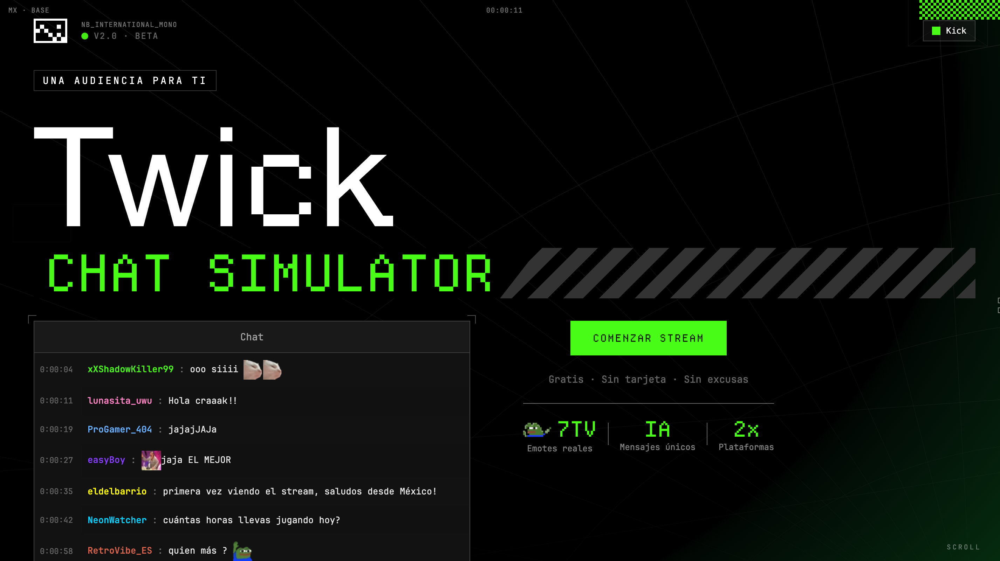

# Twick

Twick es un simulador de chat para practicar streams. Crea una audiencia para un videojuego o una conversación, transmite mensajes al dashboard en tiempo real y personaliza un overlay para OBS. La audiencia puede responder al audio del micrófono con ayuda de IA.



## Funciones

- Simulación de chat para Twitch y Kick, con modos de videojuego y *Just Chatting*.
- Personalidades de audiencia, velocidad de mensajes, saludos iniciales y reacciones rápidas.
- Generación de frases por juego o tema con Groq y Cerebras; el chat usa frases locales durante el stream.
- Reacciones a la voz del streamer desde el micrófono.
- Vista previa y personalización de un overlay transparente para OBS.
- Emotes de 7TV en los mensajes.


## Rutas principales

| Ruta | Descripción |
|---|---|
| `/` | Página de presentación. |
| `/overlay/chat` | Overlay de chat para OBS, configurado con parámetros de URL y token. |
| `/sign-in`, `/sign-up` | Inicio de sesión y registro con Clerk. |
| `/simulador-de-chat-para-twitch` | Página de presentación en español. |
| `/dev-login`, `/dev/chat` | Acceso y herramientas locales de desarrollo. |

## API

| Endpoint | Método | Uso |
|---|---|---|
| `/api/generate-phrases` | `GET`, `POST` | Consulta juegos disponibles y genera frases para un juego o tema. |
| `/api/chat-stream` | `GET` | Envía mensajes del chat mediante SSE. |
| `/api/chat-wave` | `POST` | Encola una reacción rápida mientras hay un stream activo. |
| `/api/voice-react` | `POST` | Procesa audio y contexto para generar una reacción de la audiencia. |
| `/api/overlay-token` | `GET`, `POST`, `DELETE` | Consulta, crea o revoca el token del overlay. |
| `/api/overlay-appearance` | `GET`, `PUT` | Consulta o guarda la apariencia del overlay. |

## Cómo funciona el chat

1. Al elegir un juego o tema, el servidor genera un conjunto de frases con IA y lo conserva en caché en memoria. Si no hay proveedor de IA disponible, usa los patrones locales que correspondan.
2. Al iniciar el chat, el navegador abre una conexión SSE a `/api/chat-stream`.
3. El servidor selecciona mensajes y los envía durante el stream; el navegador conserva hasta 200 mensajes visibles en la lista.
4. El overlay de OBS usa su URL con token para conectarse al mismo stream.

La caché vive en memoria del proceso y se pierde cuando se reinicia el servidor. El servidor limita a cuatro juegos por usuario para la generación de frases.

## Estructura

```text
src/
├── components/       # Dashboard, chat, controles y vista previa del overlay
├── layouts/           # Layout compartido de las páginas
├── lib/
│   ├── ai/            # Proveedores y coordinación de IA
│   ├── sevenTv/       # Catálogo y selección de emotes
│   ├── chatGenerator.ts
│   ├── messagePatterns.ts
│   ├── phraseCache.ts
│   ├── overlayTokens.ts
│   └── waveManager.ts
├── pages/
│   ├── api/           # Rutas de chat, IA, voz y overlay
│   ├── overlay/       # Vista de chat para OBS
│   └── *.astro        # Páginas del sitio y dashboard
├── middleware.ts      # Autenticación, límites y headers de seguridad
└── utils/types.ts     # Tipos compartidos
```

## Stack

Astro 7 con SSR en Node.js, React 19, Tailwind CSS 4, Clerk, TypeScript, Groq, Cerebras y `react-virtuoso`.
